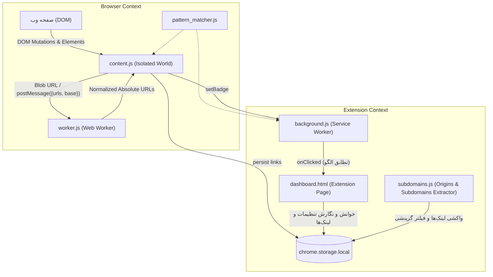
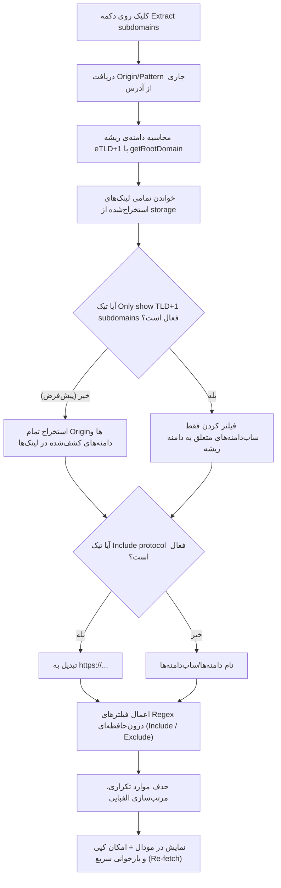

# مستندات جامع پروژه افزونه کروم — Automatic Link Extractor

> **هدف این مستند:** این فایل به عنوان مرجع اصلی و پایگاه دانش کامل پروژه تهیه شده است تا در هر زمان بتوان ساختار، معماری، منطق کد، قراردادها و باگ‌های شناخته‌شده را بررسی کرد. **این فایل طبق تعهد با هر تغییر جدید در پروژه به‌روزرسانی خواهد شد.**

---

## ۱. معرفی کلی و هدف پروژه

افزونه **Automatic Link Extractor** یک افزونه برای مرورگر گوگل کروم بر پایه **Manifest V3** است که به منظور کشف و استخراج خودکار و بلادرنگ پیوندها (Links / URLs) طراحی شده است. این افزونه سه قابلیت و پایپ‌لاین کلیدی دارد:

1. **استخراج زنده پیوندها از ساختار DOM با پشتیبانی از Wildcard Patterns (Live DOM Link Extraction):**
   یک Content Script روی وب‌سایت‌هایی که کاربر فعال (Enable) کرده یا با الگوهای وایلدکارد منطبق است اجرا می‌شود و با استفاده از `MutationObserver` هرگونه تغییر در ساختار صفحه را زیر نظر گرفته و تمامی پیوندها را از ویژگی‌های مختلف HTML (مانند `href`, `src`, `action`, `data-*` و ...) استخراج می‌کند. پیوندها به تفکیک الگو/دامنه ذخیره شده و تعداد آن‌ها در نشانگر (Badge) آیکون افزونه نمایش داده می‌شود.

2. **خزنده و تحلیل‌گر فایل‌های جاوااسکریپت (JavaScript File Crawler):**
   از طریق داشبورد افزونه، کاربر می‌تواند تمام فایل‌های اسکریپت (`.js`) کشف‌شده از دامنه را انتخاب کرده و محتوای آن‌ها را خزش (Crawl) کند تا با استفاده از الگوهای Regex بهینه‌سازی‌شده، تمامی مسیرها، اندپوینت‌های API و پیوندهای مطلق و نسبی داخل فایل‌های جاوااسکریپت استخراج شوند.

3. **استخراج جامع دامنه‌ها و ساب‌دامنه‌ها با فیلترهای Regex (Origins & Subdomains Extractor):**
   با یک کلیک روی دکمه **Extract subdomains**، تمامی لینک‌های ذخیره‌شده بررسی می‌شوند. به صورت پیش‌فرض تمام Originها/دامنه‌های پیدا شده در لینک‌ها نمایش داده می‌شوند. کاربر می‌تواند با چک‌باکس **Only show TLD+1 subdomains** خروجی را منحصراً به ساب‌دامنه‌های دامنه ریشه محدود کرده و با سیستم **Regex Filter** (شامل Include و Exclude) خروجی را به صورت زنده فیلتر کند.

4. **افزودن دستی و دلخواه لینک‌ها به تارگت (Manual Links Importer):**
   با کلیک روی دکمه `+` در کنار عنوان `🔍 Extracted Links` در داشبورد، یک پنجره مودال باز شده و کاربر می‌تواند مجموعه‌ای از لینک‌ها را در textarea وارد کند تا پس از اعتبارسنجی و حذف موارد تکراری، مستقیماً به بانک لینک‌های تارگت ذخیره شوند.

> **ویژگی فنی مهم:** این پروژه کاملاً با **Vanilla JavaScript** (جاوااسکریپت خالص استاندارد مدرن مرورگر) پیاده‌سازی شده و هیچ‌گونه وابستگی، پکیج NPM، بیلد تول (Webpack/Vite/Rollup) یا فریمورک فرانت‌اند ندارد. به صورت مستقیم در حالت Developer Mode کروم بارگذاری (Load unpacked) می‌شود.

---

## ۲. سیستم الگوها و Wildcard Matching

افزونه به جای محدود بودن به تطابق دقیق یک Origin خاص، از انواع الگوهای پیشرفته وایلدکارد پشتیبانی می‌کند:

| نوع الگو | مثال ورودی | توضیحات و دامنه پوشش |
|---|---|---|
| **ساب‌دامنه‌ها + ریشه** | `https://*.google.com` | پوشش کامل دامنه اصلی (`google.com`) و تمام زیردامنه‌ها (`mail.google.com`, `a.b.google.com`) با هر مسیری |
| **مسیرهای پیشوندی** | `https://google.com/*` | پوشش تمامی صفحات و اندپوینت‌هایی که با `https://google.com/` شروع می‌شوند (`/search`, `/images`, ...) |
| **مسیرهای خاص** | `https://google.com/search/*` | پوشش صفحات خاص یک بخش، مثلاً مسیرهای تحت `/search` |
| **ترکیب ساب‌دامنه و مسیر** | `https://*.google.com/*` | پوشش تمام ساب‌دامنه‌ها و تمام مسیرها |
| **مبدأ سنتی دقیق** | `https://google.com` | رفتار سنتی؛ استخراج لینک از تمام صفحات این مبدأ |
| **پروتکل آزاد** | `*.google.com` یا `*://*.google.com/*` | پوشش هر دو پروتکل `http` و `https` |
| **پورت‌های لوکال** | `http://localhost:3000` یا `http://localhost:*` | تست و توسعه روی پورت‌های لوکال هاست |

منطق تبدیل الگو به رگکس و بررسی تطابق به شکل مجزا در ماژول [`assets/js/pattern_matcher.js`](file:///d:/tools/Automatic%20Link%20Extractor%20-%20Chrome%20extension/assets/js/pattern_matcher.js) پیاده‌سازی شده و در تمامی محیط‌ها (`content.js`, `background.js`, `dashboard.html`) به اشتراک گذاشته شده است.

---

## ۳. معماری فنی و فضاهای اجرا (Execution Contexts)



| محیط / کامپوننت | فایل مربوطه | دسترسی به DOM؟ | دسترسی به API کروم؟ | وظیفه اصلی |
|---|---|:---:|:---:|---|
| **Service Worker** | `background.js` | ❌ خیر | ✅ بله (`chrome.*`) | لود `pattern_matcher.js` با `importScripts`، مدیریت کلیک، تشخیص الگوی منطبق با تب فعال و باز کردن داشبورد. |
| **Content Script** | `assets/js/pattern_matcher.js` + `content.js` | ✅ بله (Isolated) | ✅ بله (محدود به `storage`, `runtime`) | بررسی تطابق URL جاری با الگوهای وایلدکارد، نظارت بر DOM، ارسال کاندیدها به ورکر، ذخیره لینک‌ها در کلید مربوط به الگو. |
| **Web Worker** | `worker.js` | ❌ خیر | ❌ خیر (سندباکس ایزوله) | پردازش پس‌زمینه و موازی URLها، فیلتر اسکیماهای نامعتبر و نرمال‌سازی لینک‌ها. |
| **Extension Page** | `dashboard.html` + `assets/js/*` | ✅ بله (DOM داشبورد) | ✅ بله (دسترسی کامل) | رابط کاربری مدیریت الگوها، تنظیم حساسیت، مشاهده لینک‌ها با صفحه‌بندی امن، مودال خزنده JS و مودال استخراج ساب‌دامنه‌ها/مبدأها. |

---

## ۴. جریان داده و پایپ‌لاین‌های استخراج (Extraction Pipelines)

### ۴.۱. پایپ‌لاین اول: استخراج زنده از DOM (Pipeline A)

این فرآیند به شکل زنده در هر صفحه‌ای که آدرس آن با یکی از الگوهای ثبت شده منطبق باشد اجرا می‌شود:
1. در `document_start` نودهای زودهنگام با `earlyObserver` بافر می‌شوند.
2. با `findMatchingPatterns(origins, location.href)` الگوهای منطبق شناسایی می‌شوند.
3. در صورت انطباق، `worker.js` از طریق Blob URL ایجاد شده و DOM پویش می‌شود.
4. مقادیر اتریبیوت‌های لینک‌ساز (`href`, `src`, `srcset`, `action`, `formaction`, `data-*`, `poster`, ...) بافر و با دی‌بانس ۱۵۰ میلی‌ثانیه برای ورکر ارسال می‌شوند.
5. ورکر پیوندها را نرمال‌سازی کرده و لینک‌های یکتا و مطلق را به `content.js` پس می‌دهد.
6. لینک‌ها در زنجیره `persistChain` درون کلید الگوهای منطبق در `chrome.storage.local` ذخیره شده و Badge تب به‌روزرسانی می‌شود.

---

### ۴.۲. پایپ‌لاین دوم: خزنده فایل‌های جاوااسکریپت (Pipeline B)

1. کاربر روی **Extract links from JS files** کلیک می‌کند.
2. اسکریپت‌های استخراج‌شده برای آن الگو واکشی و در مودال لیست می‌شوند.
3. با کلیک روی **Crawl**، درخواست‌های `fetch` ارسال شده و پیوندها با رگکس‌های مطلق و نسبی استخراج می‌گردند.
4. مسیرهای نسبی نسبت به URL خود اسکریپت بازنشانی شده و با اعمال فیلترهای Regex کاربر و گزینه Decode URLs، به استوریج اضافه می‌شوند.

---

### ۴.۳. پایپ‌لاین سوم: استخراج مبدأها و ساب‌دامنه‌ها (Pipeline C - Origins & Subdomains)

این فرآیند با کلیک روی دکمه **Extract subdomains** اجرا می‌شود:



#### قابلیت‌ها و گزینه‌های مودال:
1. **نمایش پیش‌فرض (Default):** نمایش تمام دامنه‌ها/Originهای کشف‌شده در کلیه لینک‌های صفحه بدون هیچ فیلتری (شامل دامنه‌های متفرقه، CDNها، APIهای خارجی و ...).
2. **چک‌باکس Only show TLD+1 subdomains:** در صورت فعال شدن، لیست بلافاصله فیلتر شده و تنها ساب‌دامنه‌هایی که به دامنه اصلی ریشه (eTLD+1) تعلق دارند نمایش داده می‌شوند (مثلاً برای `google.com` فقط ساب‌دامنه‌هایی چون `apis.google.com` و `mail.google.com` نمایش می‌یابند).
3. **فیلترهای عبارت باقاعده درون‌حافظه‌ای (Include & Exclude Regexes):** ایجاد پیل‌های ریجکس تعاملی با کلیک روی دکمه `+` دقیقا با همان استایل‌ها، کلاس‌ها و ساختار جاوااسکریپتی خزشگر فایل‌های JS (`contenteditable`، دکمه حذف `-`، و فرمت `/ pattern /g`). این فیلترها فقط روی خروجی فعال همان نشست اعمال می‌شوند و نیازی به ذخیره شدن در استوریج ندارند.
4. **چک‌باکس Include protocol:** امکان تغییر فرمت بین نام تمیز هاست (`sub.example.com`) و مبدأ کامل وب (`https://sub.example.com`).
5. **دکمه Re-fetch (⟳):** واکشی مجدد زنده از حافظه بدون بستن پنجره مودال برای دریافت لینک‌های جدیدی که به تازگی در پس‌زمینه توسط مانیتورینگ DOM ثبت شده‌اند.
6. **الگوریتم eTLD+1:** با پوشش پسوندهای چندبخشی اینترنتی (`MULTI_PART_TLDS`) از قبیل `.co.uk`, `.ac.ir`, `.com.tr`, `.org.uk` و ...

---

## ۵. ساختار داده در `chrome.storage.local`

فضای ذخیره‌سازی محلی افزونه شامل چهار کلید اصلی است:

### ۵.۱. `origins` (`string[]`)
آرایه‌ای از الگوها و دامنه‌های ثبت‌شده، شامل دامنه‌های دقیق یا عبارات وایلدکارد:
```json
[
  "https://*.google.com",
  "https://example.com/*",
  "http://localhost:3000"
]
```

### ۵.۲. `sensitivities` (`{ [pattern: string]: Object }`)
تنظیمات پرچم‌های `MutationObserver` به ازای هر الگو (به صورت پیش‌فرض با `1` ایجاد می‌شوند):
```json
{
  "https://*.google.com": {
    "childList": 1,
    "subtree": 1,
    "attributes": 1,
    "attributeOldValue": 1,
    "characterData": 1,
    "characterDataOldValue": 1
  }
}
```

### ۵.۳. `regexes` (`{ [pattern: string]: { includes: string[], excludes: string[] } }`)
الگوهای فیلتر شمول یا عدم شمول خزشگر فایل‌های JS به تفکیک هر الگو:
```json
{
  "https://*.google.com": {
    "includes": ["api", "YOUR_REGEX"],
    "excludes": ["node_modules", "YOUR_REGEX"]
  }
}
```

### ۵.۴. `links` (`{ [pattern: string]: string[] }`)
مجموعه لینک‌های یکتای استخراج‌شده برای آن الگو (مثلاً برای `https://*.google.com` شامل لینک‌های جمع‌آوری‌شده از `google.com` و تمامی ساب‌دامنه‌ها):
```json
{
  "https://*.google.com": [
    "https://google.com/",
    "https://mail.google.com/mail/u/0/",
    "https://drive.google.com/drive/my-drive"
  ]
}
```

---

## ۶. بررسی تفکیکی فایل‌های پروژه

### `assets/js/settings.js`
- مدیریت پنجره مودال تنظیمات استخراج (`#settingsModal`):
  - باز شدن با کلیک روی دکمه `#open_settings` (دارای آیکون SVG چرخ‌دنده).
  - مدیریت اینپوت‌های ریجکس Include و Exclude جهت تعیین شروط پذیرش لینک‌های زنده در حین وب‌گردی.
  - ذخیره‌سازی خودکار در کلید `extraction_rules` در `chrome.storage.local`.
  - مقداردهی اولیه هنگام افزودن تارگت در `addorigin.js` و پاک‌سازی کامل هنگام حذف تارگت.

### `assets/js/subdomains.js`
- مدیریت استخراج Origins و Subdomains:
  - مجموعه `MULTI_PART_TLDS`: پوشش پسوندهای چندبخشی.
  - `extractHostnameFromPattern(pattern)`: استخراج نام هاست از الگو.
  - `getRootDomain(hostname)`: محاسبه دامنه ریشه eTLD+1.
  - `extractOriginsOrSubdomains(links, rootDomain, { onlyTld, includeProtocol, includes, excludes })`: استخراج گزینشی بر اساس چک‌باکس‌ها و فیلترهای Regex درون‌حافظه‌ای.
  - پیاده‌سازی اینپوت‌های پیل‌مانند Regex مشابه `modal.js` با دکمه `+` و دکمه `-` و اعمال بلادرنگ در زمان `keyup`.
  - دکمه کپی بالای کادر متنی (`#copySubdomainsBtn`).

### `assets/js/custom_links.js`
- مدیریت افزودن دستی پیوندها به تارگت فعلی:
  - باز کردن پنجره مودال اختصاصی `#addLinksModal` با کلیک روی دکمه `+` در کنار عنوان لینک‌های استخراج‌شده.
  - دریافت ورودی چندخطی از textarea، پاک‌سازی فضاهای خالی و خطوط تهی، شمارش زنده تعداد لینک‌ها.
  - ادغام امن با لینک‌های قبلی در `chrome.storage.local` با حذف موارد تکراری (`Set`) و رفرش خودکار داشبورد.

### `assets/js/pattern_matcher.js`
- ماژول متمرکز و مستقل برای تطابق الگوها و وایلدکاردها.
- توابع کلیدی: `escapeRegex`، `patternToRegex`، `matchPattern` و `findMatchingPatterns`.

### `manifest.json`
- تعریف استاندارد **Manifest V3**.
- مجوزها (Permissions): `storage`, `tabs` و مجوز مدرن `declarativeNetRequestWithHostAccess` جهت تزریق و تنظیم هدرهای سفارشی HTTP بر روی تب‌های کرالر بدون نمایش هشدارهای امنیتی ناخواسته.
- اضافه شدن `pattern_matcher.js` به عنوان اسکریپت پیش‌نیاز در `content_scripts`.
- دسترسی به میزبان: `<all_urls>`.

### `background.js` (Service Worker)
- بارگذاری `pattern_matcher.js` با استفاده از `importScripts`.
- در زمان کلیک کاربر روی آیکون، آدرس تب فعال (`tab.url`) را با الگوهای ثبت‌شده تطبیق داده و در صورت انطباق، مستقیماً داشبورد مربوط به همان الگو را باز یا فوکوس می‌کند.

### `content.js` (Content Script)
- اجرای زودهنگام در `document_start`.
- پایش و استخراج بلادرنگ کلیه درخواست‌های شبکه (Network / Resource Timing) از طریق `PerformanceObserver` و `performance.getEntriesByType("resource")` برای شکار درخواست‌های پس‌زمینه (Fetch, XHR, Beacon, Dynamic Assets) در فریم اصلی و آی‌فریم‌های هم‌مبدأ.
- استفاده از `findMatchingPatterns(arr, location.href)` برای تشخیص فعال بودن پایش در صفحه جاری.
- ادغام لینک‌های جدید در بانک لینک‌های تمامی الگوهای منطبق در `persist(links)`.

### `assets/js/dash_checker.js`
- استفاده از `URLSearchParams`؛ پشتیبانی کامل و بدون خطا از کاراکترهای وایلدکارد و پارامترهای مختلف.

### `assets/js/addorigin.js`
- افزودن الگوها با انکود امن URL (`encodeURIComponent`).
- مقداردهی اولیه `sensitivities`، `regexes`، `extraction_rules` و `links`.
- نمایش دیالوگ تأیید (`confirm()`) قبل از حذف مبدأ در دکمه `.removeLogBtn`.
- پاک‌سازی کامل تمام کلیدهای وابسته (`origins`, `sensitivities`, `regexes`, `extraction_rules`, `links`) به همراه پوشش واریانت‌های مختلف در هنگام حذف یک الگو.

### `assets/js/dashboard.js`
- حل مشکل کرش صفحه در زمان خالی بودن لینک‌ها (گارد روی `page_count > 0`).
- رفع باگ دکمه ضربدر حذف تکی لینک با پیاده‌سازی تابع اختصاصی `remove_link_from_origin`.
- پیاده‌سازی جستجوی زنده (Live Search) از طریق فیلد ورودی `#searchLinksInput`:
  - فیلتر آنی لینک‌ها هنگام تایپ (`input`).
  - محاسبه مجدد و بلادرنگ صفحه‌بندی (Pagination) روی نتایج فیلترشده.
  - تعویض صفحات به صورت کاملاً داینامیک و درجا در DOM (بدون رفرش صفحه) همراه با همگام‌سازی پارامترهای `page` و `q` در URL با `history.replaceState`.
- نمایش تعداد کل لینک‌های استخراج‌شده و تعداد لینک‌های منطبق با جستجو در هدر داشبورد.

### `assets/js/helpers.js`
- شامل توابع کمکی مشترک: `getQueryParam` و `copyToClipboard`.
- پاک‌سازی تمام لینک‌های مبدأ با `#removeAllBtn`.
- عملکرد هوشمند دکمه `#copy_all`:
  - کپی تمام لینک‌های تارگت در حالت عادی.
  - در صورت فعال بودن جستجو در `#searchLinksInput`، منحصراً نتایج منطبق با فیلتر جستجو در کلیپ‌بورد کپی می‌شوند.

### `dashboard.html`
- چیدمان مدرن و بهینه‌سازی‌شده دکمه‌ها و ابزارها:
  - دکمه قرمز و جمع‌وجور **Remove All** (`#removeAllBtn`) به همراه دکمه سبز `+` (`#openAddLinksModalBtn`) در کنار هدر `🔍 Extracted Links` قرار گرفته‌اند.
  - پیوند کلیک‌پذیر راست‌چین **Copy all to clipboard** (`#copy_all`) بلافاصله در زیر فهرست لینک‌ها قرار داده شده است.
  - دکمه‌های اصلی ابزارها شامل **Extract links from JS files**، **Extract subdomains** و دکمه جدید **Settings** (`#open_settings` با آیکون چرخ‌دنده) در کانتینر پایینی (`.buttons_container`) قرار دارند.
  - بهبود ساختار هدر بخش مبدأها با نشانگر تعداد کل Originها (`#originCountBadge`)، فیلد جستجوی زنده مبدأها (`#searchOriginsInput`)، یادداشت راهنمای وایلدکاردها و صفحه‌بندی اختصاصی مبدأها (`#originPagination`).
- پنجره‌های مودال اختصاصی: مودال خزشگر جاوااسکریپت (`#myModal`)، مودال ساب‌دامنه‌ها (`#subdomainModal`)، مودال ورود دستی لینک‌ها (`#addLinksModal`) و مودال تنظیمات استخراج (`#settingsModal`).
- فیلدهای جستجوی بلادرنگ `#searchLinksInput` و `#searchOriginsInput`.
- دکمه اختصاصی **Auto Crawl** (`#openAutoCrawlBtn`, `.auto-crawl-btn`) با آیکون وکتور عنکبوت/خزشگر (`assets/images/crawler.svg`) مستقیماً زیر بخش تنظیمات Sensitivity (`div.input-group`) در `origin_dashboard` جهت باز کردن پنل خزش خودکار صفحات تارگت جاری.
- لود اسکریپت‌های ماژولار: `pattern_matcher.js`، `dashboard.js`، `sensitivities.js`، `modal.js`، `subdomains.js`، `custom_links.js` و `settings.js`.

### `crawler.html` و `assets/js/crawler.js`
- داشبورد اختصاصی و پیشرفته خزش خودکار (Auto Crawler):
  - شناسایی خودکار تارگت مبدأ از پارامتر `origin` و اتصال به داده‌های همان تارگت.
  - مدیریت چرخه حیات شیء `crawler_state` در `chrome.storage.local` (بارگذاری وضعیت قبلی یا ایجاد صف اولیه بر اساس ریشه تارگت و لینک‌های استخراج‌شده قبلی).
  - نوار پیشرفت زنده (`.progress-bar-fill`) و نمایش درصد پیشرفت عددی (`0%` تا `100%`).
  - کارت‌های آماری سه‌گانه: صفحات کرال‌شده (`#crawledCount`)، تعداد لینک‌های در صف/باقی‌مانده (`#remainingCount`) و کل لینک‌های کشف‌شده (`#totalCount`).
  - کادر نمایش بلادرنگ آدرس در حال کرال (`#currentLinkText`).
  - کنترل کامل فرآیند با دکمه‌های کنترلی چهارگانه: Start (`#startCrawlerBtn`)، Pause (`#pauseCrawlerBtn`)، Resume (`#resumeCrawlerBtn`) و Stop (`#stopCrawlerBtn`) به همراه ریست صف (`#resetCrawlerBtn`).
  - فرم تنظیمات خزشگر: تاخیر زمانی (Delay)، سقف عمق (Max Depth)، سقف کل صفحات (Max Pages)، سقف زمان پاسخ‌دهی (Timeout)، چک‌باکس رعایت محدوده تارگت (Stay in Scope) و فیلتر سفارشی پسوندهای فایل (#crawlerExcludedExtensions).
  - تنظیم زمان مجاز پاسخ‌دهی (Request / Page Timeout): فیلد ورودی عددی `#crawlerTimeout` (با مقدار پیش‌فرض ۱۵ ثانیه) جهت تعیین حداکثر مهلت انتظار برای بارگذاری تب مرورگر یا دریافت پاسخ درخواست شبکه قبل از Skip شدن صفحه در هر دو حالت خزش.
  - فیلتر الگوهای آدرس ممنوعه / بلک‌لیست (Excluded URL Patterns / Blacklist): کادر متنی چندخطی `#crawlerExcludedUrls` جهت تعیین الگوهای ممنوعه (یک الگو در هر خط یا جدا شده با کاما) به صورت وایلدکارد (مانند `https://site.tld/admin/*` یا `/private/*`) یا نشانی مطلق (مانند `https://site.tld/logout`). تطابق الگوها با تابع `isUrlBlacklisted` انجام گرفته و پیوندهای منطبق از صف خزش و خزش تب/فچ حذف و آمار صف فوراً به‌روزرسانی می‌شود.
  - تنظیم و ارسال هدرهای سفارشی HTTP (Custom Request Headers): کانتینر `#crawlerHeadersList` و دکمه `#addHeaderBtn` جهت افزودن و حذف نامحدود هدرها (مانند `Authorization`, `X-Custom-Header`, `Cookie`) به همراه شمارنده زنده (`#crawlerHeadersCount`). پشتیبانی از تفکیک خودکار `Name: Value` در صورت پیست در کادر نام. اعمال روی حالت Fetch از طریق شیء هدرهای ساخته‌شده توسط `buildHeadersObject` و اعمال روی حالت تب از طریق رول‌های سشن `chrome.declarativeNetRequest.updateSessionRules` منحصراً برای تب کرالر جاری با پاک‌سازی خودکار در زمان خروج.
  - قابلیت جمع شدن و باز شدن کارت تنظیمات (Collapsible Settings Card): افزودن دکمه Minimize / Maximize (`#toggleSettingsBtn`) در هدر کارت تنظیمات خزشگر، تغییر آیکون و متن دکمه به صورت داینامیک، مخفی/نمایان‌سازی محتوای تنظیمات (`#crawlerSettingsBody`) با کلاس `.is-collapsed`، امکان کلیک روی دکمه یا نوار هدر کارت، و ماندگاری وضعیت انتخابی کاربر در `localStorage`.
  - فیلتر پسوندهای قابل تنظیم توسط کاربر (crawlerExcludedExtensions): ورودی متنی برای وارد کردن پسوند فایل‌هایی که نباید کرال شوند با جداکننده کاما `,` (شامل مقادیر پیش‌فرض تصاویر، استایل‌ها، فونت‌ها، آرشیوها و ...). همراه با اعتبارسنجی بلادرنگ (`parseAndValidateExtensions`)، نمایش نشانگر تعداد پسوندهای فیلترشده (`#crawlerExcludedCount`)، تغییر رنگ کادر به قرمز در صورت وجود کاراکترهای نامعتبر، اعمال بر روی هر دو حالت خزش (Fetch و Tab-driven) و به‌روزرسانی آنی آمار صف خزش (Queue, Total, Percent) به محض تغییر ورودی.
  - اعمال داینامیک و بلادرنگ تنظیمات: موتور خزشگر قبل از شروع کرال هر لینک، آخرین تنظیمات را مستقیماً از استوریج بازخوانی می‌کند؛ بنابراین هرگونه تغییر کاربر حین خزش سریعاً روی ادامه فرآیند اعمال می‌شود.
  - استخراج خودکار لینک‌های جدید، تطبیق با قوانین Include/Exclude تارگت، فیلتر پسوندهای فایل‌های مدیا و ذخیره آنی لینک‌های کشف‌شده در دیتابیس اصلی تارگت (`links[origin]`).
  - جعبه لاگ‌های زنده فعالیت خزشگر با زمان دقیق، وضعیت موفقیت و تعداد لینک‌های کشف‌شده.
  - پشتیبانی از دو حالت ناوبری: حالت سریع متنی (Fast Background Fetch) و حالت ناوبری از طریق تب مرورگر (Tab-driven Navigation) جهت رندرینگ کامل کدهای جاوااسکریپت، کوکی‌ها و فریم‌ورک‌های SPA.
  - تنظیمات اختصاصی ناوبری تب: تعیین تاخیر مکث پس از لود صفحه (`pageWaitDelay` بر حسب ثانیه جهت اتمام رندر JS و AJAX)، اجرای نامحسوس تب در پس‌زمینه (`tabBackground`) و بستن خودکار تب خزشگر پس از اتمام فرآیند (`autoCloseTab`).
  - لیسنر پیام‌رسانی `extractTabLinks` در `content.js` جهت واکشی آنی تمام پیوندهای زنده DOM، شَدو روت‌ها (Shadow Roots) و فریم‌های تب جاری.

### `assets/styles/style.css` و `assets/styles/modal.css`
- استایل‌دهی بنفش به دکمه `#extract_subdomains` و اعمال استایل دکمه‌های کپی و کادر textarea مودال.
- استایل دکمه سبز رنگ `+` (`#openAddLinksModalBtn`) و کادر ورودی سفید رنگ لینک‌های دستی (`#customLinksInput`).
- استایل‌دهی مدرن به دکمه Auto Crawl (`.auto-crawl-btn`, `#openAutoCrawlBtn`) با رنگ نارنجی گرم (`#ea580c` / hover `#c2410c`)، افکت سایه و فشردن (active scale)، چیدمان flex و فیلتر معکوس‌سازی رنگ آیکون به سفید خالص.

---

## ۷. آخرین تغییرات اعمال شده در پروژه (Git History)

1. **قابلیت جمع‌شدن و بازشدن (Minimize / Maximize) کارت تنظیمات کرالر (`crawler.html`, `crawler.js`, `assets/styles/crawler.css`):**
   - افزودن دکمه اختصاصی `#toggleSettingsBtn` به همراه آیکون وکتور چرخان (`#toggleSettingsIcon`) و برچسب متنی (`#toggleSettingsText`) در هدر کارت تنظیمات کرالر (`#crawlerSettingsHeader`).
   - امکان سوئیچ بین دو وضعیت Minimize و Maximize با کلیک روی دکمه یا کلیک روی نوار عنوان کارت.
   - در وضعیت Minimize (کلاس `.is-collapsed`): محتوای تنظیمات (`#crawlerSettingsBody`) به طور کامل مخفی شده، مارجین پایینی هدر صفر می‌شود و کارت به شکل یک نوار باریک، تمیز و کم‌جا درمی‌آید؛ برچسب دکمه به "Maximize" تغییر یافته و آیکون آن ۱۸۰ درجه می‌چرخد.
   - بهبود جلوه‌های بصری و چیدمان کارت تنظیمات: تفکیک بخش‌های مختلف تنظیمات با خطوط جداکننده ملایم گرادیانی (`.spliter-line`) و افزودن راهنمای مقادیر پیش‌فرض برای پسوندهای فایل.
   - حفظ یکپارچگی داده‌ها: تمامی اینپوت‌ها در DOM حفظ می‌شوند تا لوپ خزش و ذخیره‌سازی خودکار بدون کوچک‌ترین وقفه کار کنند.
   - ماندگاری وضعیت در `localStorage` (`crawler_settings_collapsed`) جهت حفظ چینش انتخابی کاربر در رفرش‌ها یا مراجعات بعدی.

1. **افزودن امکان تعریف و ارسال هدرهای سفارشی HTTP (Custom Request Headers) در کرالر (`manifest.json`, `crawler.html`, `crawler.js`, `assets/styles/crawler.css`):**
   - افزودن بخش مدیریت هدرهای سفارشی در داشبورد خزشگر با امکان افزودن پویا (`+ Add Header`)، حذف سطر (`✕`) و نشانگر زنده تعداد هدرها (`#crawlerHeadersCount`).
   - قابلیت هوشمند Auto-Split: در صورت پیست یا تایپ عبارت `Header-Name: Header-Value` درون اینپوت نام هدر، به طور خودکار به فیلد نام و مقدار تفکیک می‌شود.
   - اعمال یکپارچه بر روی هر دو حالت خزش:
     - **حالت واکشی سریع (Fast Background Fetch):** ساخت شیء دیکشنری از هدرهای معتبر با `buildHeadersObject` و تزریق مستقیم به درخواست‌های `fetch()` و ریکوئست فال‌بک تب.
     - **حالت ناوبری تب مرورگر (Tab-driven Navigation):** استفاده از API استاندارد Manifest V3 یعنی `chrome.declarativeNetRequest.updateSessionRules` (شناسه رول موقت `8888`) فیلترشده انحصاری بر روی `tabIds: [crawlerTabId]` برای اعمال روی تمام درخواست‌های تب خزشگر (شامل فریم اصلی، ساب‌فریم‌ها و درخواست‌های XHR) بدون تداخل با سایر تب‌های کاربر.
     - پاک‌سازی خودکار رول‌های سشن در `closeCrawlerTabIfNeeded` هنگام توقف، اتمام یا ریست صف خزشگر.
   - اضافه شدن دسترسی `declarativeNetRequestWithHostAccess` به `manifest.json` جهت دسترسی بدون مجوزهای سنگین یا هشدارهای ناخوشایند نصب.
   - ذخیره‌سازی خودکار در `crawler_configs` و `crawler_state.settings` با بازخوانی بلادرنگ در هر چرخه خزش.

1. **فیلتر بلک‌لیست الگوهای آدرس وایلدکارد و مطلق (Excluded URL Patterns / Blacklist) در کرالر (`crawler.html`, `crawler.js`):**
   - افزودن کادر متنی چندخطی `#crawlerExcludedUrls` در پنل تنظیمات کرالر جهت دریافت الگوهای نامطلوب به صورت خط‌به‌خط یا جدا با کاما `,`.
   - پشتیبانی جامع از الگوهای وایلدکارد (مثل `https://site.tld/admin/*`, `*/logout`, `/private/*`, `*//secret*`) و آدرس‌های دقیق و مطلق (مثل `https://site.tld/logout`).
   - پیاده‌سازی تابع اعتبارسنجی و تطابق `isUrlBlacklisted`: استفاده از توان تطابق ماژول `pattern_matcher.js` و عبارات باقاعده داینامیک برای اعتبارسنجی مسیر و کل آدرس URL.
   - اعمال یکپارچه بر هر دو حالت خزش (Fast Fetch و Tab-driven Navigation): حذف الگوهای ممنوعه در زمان ساخت صف اولیه (`buildInitialQueue`)، پالایش صف موجود هنگام لود، گارد بررسی قبل از ارسال درخواست/ناوبری تب در `runCrawlLoop`، و فیلتر کردن لینک‌های کاندیدای جدید کشف‌شده.
   - نمایش نشانگر زنده تعداد قوانین فعال بلک‌لیست (`#crawlerExcludedUrlsCount`) و به‌روزرسانی بلادرنگ آمار صف خزش و کارت‌ها بلافاصله پس از تغییر ورودی کاربر.

1. **تنظیم سقف زمان انتظار (Request / Page Timeout) در هر دو حالت خزش (`crawler.html`, `crawler.js`):**
   - افزودن فیلد ورودی عددی `#crawlerTimeout` به همراه برچسب مقدار زنده (`#crawlerTimeoutValue`) در گرید تنظیمات خزشگر (محدوده ۲ تا ۱۲۰ ثانیه با مقدار پیش‌فرض ۱۵ ثانیه).
   - اعمال هوشمند تایم‌اوت در **حالت سریع (Fast Fetch)** با استفاده از `AbortController` و سیگنال انصراف برای قطع سریع ریکوئست‌های مسدود یا کند و ثبت خطای `Timeout (Xs)` در لاگ زنده بدون متوقف شدن لوپ خزش.
   - اعمال تایم‌اوت در **حالت ناوبری تب مرورگر (Tab-driven Navigation)** بر روی تابع `waitForTabLoad` و کنترل مهلت پاسخ‌دهی پیام‌رسانی `requestTabLinks` جهت جلوگیری از معطل ماندن خزشگر روی تب‌های کرش‌کرده یا صفحات با پردازش بی‌نهایت جاوااسکریپت.
   - بازخوانی بلادرنگ تایم‌اوت قبل از پردازش هر لینک و ذخیره‌سازی خودکار در تنظیمات تارگت.

1. **فیلتر سفارشی پسوندهای فایل برای خزشگر با اعتبارسنجی و به‌روزرسانی آنی آمار (`crawler.html`, `crawler.js`):**
   - افزودن فیلد ورودی متنی `#crawlerExcludedExtensions` در تنظیمات خزشگر جهت دریافت لیست پسوندهای ممنوعه با جداکننده کاما `,` (شامل مقادیر پیش‌فرض انواع پسوندهای تصویری، صوتی، ویدئویی، فونت، آرشیو، استایل و اسکریپت).
   - پیاده‌سازی تابع اعتبارسنجی بلادرنگ `parseAndValidateExtensions`: تفکیک توکن‌ها، حذف نقطه‌های ابتدایی اضافی، پاک‌سازی فاصله‌ها، تشخیص کاراکترهای نامعتبر و شمارش تعداد پسوندهای یکتا (`X excluded`).
   - ارائه بازخورد بصری زنده: تغییر رنگ کادر ورودی به قرمز در صورت ورود کاراکترهای نامعتبر و نمایش پیام هشدار در برچسب تعداد.
   - اعمال یکنواخت فیلتر پسوندها بر روی هر دو متد خزش (Fast Fetch و Tab-driven Navigation) در فاز ساخت صف اولیه (`buildInitialQueue`)، اعتبارسنجی قبل از ناوبری/فچ (`runCrawlLoop`) و فیلتر کاندیداهای جدید کشف‌شده.
   - امکان کرال انتخابی فایل‌های استاتیک: در صورتی که کاربر پسوندی مانند `js` یا `css` را از لیست حذف کند، خزشگر فوراً آن فایل‌ها را برای استخراج پیوند بررسی و ویزیت می‌کند. در صورت خالی گذاشتن فیلد ورودی، هیچ پسوندی فیلتر نخواهد شد.
   - به‌روزرسانی خودکار و بلادرنگ آمار و نوار پیشرفت: با هر بار تغییر اینپوت، صف خزش در صورت فعال بودن وضعیت `idle` مجدداً پالایش شده و در صورت `running` یا `paused` بودن، آدرس‌های منطبق بر پسوندهای جدید از صف حذف می‌شوند و کارت‌های `Queue / Remaining`، `Total Discovered` و درصد پیشرفت بلافاصله به‌روزرسانی می‌شوند.

2. **پیاده‌سازی حالت ناوبری تب مرورگر در خزشگر (Tab-driven Navigation) و استخراج بلادرنگ (`crawler.html`, `crawler.js`, `content.js`):**
   - افزودن قابلیت خزش با تب مرورگر واقعی (Tab-driven Navigation) برای ثبت ۱۰۰٪ صفحات داینامیک، فریم‌ورک‌های SPA (React/Vue)، کوکی‌ها و درخواست‌های ایجکس.
   - افزودن فیلد تنظیم زمان مکث پس از اتمام بارگذاری صفحه (`pageWaitDelay`) جهت تکمیل رندرینگ جاوااسکریپت قبل از خواندن پیوندها.
   - اضافه شدن گزینه‌های اجرای تب در پس‌زمینه (`tabBackground`) برای جلوگیری از مزاحمت بصری کاربر و بستن خودکار تب پس از اتمام خزش (`autoCloseTab`).
   - افزودن لیسنر پیام‌رسانی `extractTabLinks` در `content.js` جهت پاسخگویی به درخواست‌های بلادرنگ خزشگر تب و استخراج جامع لینک‌های لایو DOM.
   - به‌روزرسانی زنده درصد پیشرفت، شمارنده‌ها، وضعیت و لاگ‌ها به ازای هر تب خزش‌شده.
   - اصلاح باگ لاگ شمارنده لینک‌های هر درخواست (`.log-extracted-count`): تفکیک دقیق لینک‌های استخراج‌شده از صفحه جاری از کل لینک‌های ذخیره‌شده قبلی تارگت، به طوری که در لاگ هر ردیف صرفاً تعداد لینک‌های کشف‌شده همان صفحه (مثلاً `+24 links`) درج می‌شود.
   - اعمال اعتبارسنجی سفت‌وسخت محدوده تارگت (Strict Scope Enforcement): فیلتر کردن لینک‌های ورودی به صف اولیه از استوریج بر اساس الگوی تارگت (`isUrlInScope`)، پالایش خودکار صف ذخیره‌شده از قبل در زمان لود صفحه، و اعتبارسنجی مجدد دامنه تارگت قبل از ناوبری تب یا فچ روی هر پیوند جهت جلوگیری قطعی از خزش دامنه‌های خارجی (مانند دامنه‌های خارج از وایلدکارد `https://*.site.tld/*`).

2. **پیاده‌سازی داشبورد اختصاصی Auto Crawler و موتور خزش خودکار (`crawler.html`, `crawler.js`, `crawler.css`, `dashboard.js`):**
   - اتصال دکمه Auto Crawl در صفحه تارگت به داشبورد اختصاصی خزشگر با انتقال امن پارامتر `origin`.
   - ایجاد و مدیریت شیء `crawler_state` در `chrome.storage.local` با پشتیبانی کامل از همگام‌سازی بین تب‌ها و ماندگاری وضعیت.
   - طراحی نوار پیشرفت درصدی، شمارنده‌های عددی (کرال‌شده، در صف و کل) و نمایش زنده لینکی که کرالر در لحظه در حال بررسی آن است.
   - پیاده‌سازی دکمه‌های کنترل فرآیند شامل Start, Pause, Resume, Stop و Reset Queue.
   - امکان تنظیم بلادرنگ پارامترهای خزش (Delay, Max Depth, Max Pages, Stay in Scope) با بازخوانی درجا در هر مرحله از حلقه خزش جهت اعمال آنی تغییرات کاربر.
   - استخراج، نرمال‌سازی URLها و ذخیره‌سازی خودکار لینک‌های مکشوفه در جدول لینک‌های اصلی تارگت.

2. **طراحی آیکون و دکمه پنل Auto Crawl در صفحه هر تارگت (`dashboard.html`, `crawler.svg`, `style.css`):**
   - طراحی آیکون وکتور اختصاصی خزشگر (`crawler.svg`) با طراحی مدرن خزشگر/عنکبوت (مطابق با استایل Lucide/Feather در سایز 16x16 و stroke تمیز).
   - افزودن دکمه `#openAutoCrawlBtn` (`.auto-crawl-btn`) در کانتینر `.auto-crawl-container` مستقیماً زیر تگ `div.input-group` (تنظیمات حساسیت) در `origin_dashboard`.
   - استایل‌دهی متمایز با رنگ نارنجی/کهربایی جذاب (`#ea580c` با هاور `#c2410c` و سایه نئونی)، هماهنگ با ساختار دکمه‌های اصلی داشبورد و دارای آیکون سفید معکوس‌شده.

2. **پیاده‌سازی صفحه‌بندی (Pagination) اختصاصی برای فهرست Originها (`addorigin.js`, `dashboard.html`):**
   - افزودن کانتینر `#originPagination` با همان استایل بصری استاندارد پیجینیشن لینک‌ها (`.pagination`, `.page-button`, `.page-button-active`).
   - تنظیم محدودیت ۷ آیتم در هر صفحه (`per_page = 7`) برای خلوت‌تر و منظم‌تر شدن صفحه اصلی داشبورد.
   - هماهنگی و همگام‌سازی کامل با فیلد جستجوی `#searchOriginsInput` (محاسبه مجدد تعداد صفحات بر اساس نتایج جستجو و بازنشانی خودکار به صفحه اول).
   - ایزوله‌سازی کوئری سلکتورهای پیجینیشن در `dashboard.js` جهت پیشگیری از تداخل با پیجینیشن لینک‌ها.
2. **افزودن امکان جستجوی بلادرنگ در فهرست Originها (`e8e7da6`):**
   - افزودن فیلد ورودی `#searchOriginsInput` بلافاصله در زیر هدر `.origin-header`.
   - فیلتر کردن زنده و بلادرنگ کارت‌های مبدأ بر اساس متن وارد شده بدون رفرش صفحه.
   - تطبیق خودکار نشانگر تعداد در هدر (`originCountBadge`) هنگام جستجو (مثلاً `2 of 5`).
   - نمایش پیام راهنما در زمان عدم یافتن هیچ نتیجه‌ای برای عبارت جستجوشده.
2. **بهبود بصری بخش Originها و افزودن نشانگرهای آماری (`daed22a`):**
   - نمایش نشان تعداد لینک‌های کشف‌شده برای هر مبدأ (`origin-link-count`) در کنار دکمه حذف `.removeLogBtn`.
   - نمایش شمارنده کل Originهای ثبت‌شده در هدر (`originCountBadge` در کنار `🔍 Origin List`).
   - تبدیل توضیحات طولانی placeholder ورودی مبدأ به یک یادداشت راهنما (`origin-input-note`) در زیر اینپوت با پشتیبانی از کدهای نمونه الگوهای وایلدکارد.
   - اضافه شدن حالت پیش‌نمایش خالی (Empty state) برای زمانی که هنوز هیچ مبدأیی ثبت نشده است.
   - بهینه‌سازی استایل‌های CSS و محدودسازی عرض لینک مبدأ جهت جلوگیری از به‌هم‌ریختگی چیدمان در نام‌های طولانی.
2. **افزودن دیالوگ تأیید (Confirm) و پاک‌سازی کامل داده‌ها در حذف Origin (`2522d28`):**
   - نمایش پیام تأیید `confirm()` پیش از اقدام به حذف Origin در دکمه‌های `.removeLogBtn` جهت پیشگیری از حذف تصادفی.
   - حذف همه‌جانبه تمام داده‌های ذخیره‌شده مرتبط با مبدأ/الگو از استوریج (`links`، `regexes`، `extraction_rules`، `sensitivities`) به همراه پوشش کلیه واریانت‌های ممکن (با و بدون اسلش پایانی، کدگذاری URL و trim).
   - توقف انتشار رویداد با `stopPropagation` و هدایت صحیح کاربر به ریشه داشبورد در صورت باز بودن تب تارگت حذف‌شده.
2. **حذف پرمیشن بلااستفاده `scripting` از مانیفست (`6f3dfd5`):**
   - حذف مجوز غیرضروری `"scripting"` از آرایه `permissions` در `manifest.json`.
   - پیروی از اصل حداقل دسترسی (Least Privilege) و برطرف کردن هشدارهای غیرضروری مجوزها در مرورگر.
2. **حذف کد مرده در پیام‌رسانی `content.js` (`3d06a0f`):**
   - حذف دستور `window.postMessage({ action: "continue", url: location.href })` پس از ذخیره لینک‌ها در `chrome.storage.local`.
   - پاک‌سازی سربار پیام‌رسانی زاید و جلوگیری از انتشار داده‌های افزونه به شیء سراسری `window` صفحه وب.
2. **امن‌سازی تزریق DOM و پیشگیری از XSS در لیست فایل‌های JS (`f8bea4b`):**
   - جایگزینی ساخت رشته‌ای HTML از طریق `innerHTML` با ایجاد امن گره‌های DOM (`document.createElement`، `setAttribute` و `textContent`).
   - تنظیم امن ویژگی‌های `title`، `href` و اضافه کردن `rel="noopener noreferrer"` به پیوند باز کردن فایل‌ها.
   - جایگزینی `innerHTML` با `textContent` در نمایش فایل جاری (`current_file`) و مقادیر ریجکس جهت جلوگیری از هرگونه تزریق یا پارس ناخواسته تگ‌های HTML.
3. **رفع باگ ورودی نامعتبر Regex در خزشگر فایل‌های جاوااسکریپت (`57dc6cc`):**
   - افزودن تابع کمکی `getRegexList` جهت واکشی و فیلتر کردن مقادیر بدون خطا و بدون وابستگی به متن‌های خالی یا ناقص.
   - پوشش‌دهی کامل دستورات `new RegExp(pattern, 'i').test(...)` درون بلاک `try / catch` در فیلترهای Include و Exclude.
   - جلوگیری از توقف و شکست Promise خزش فایل‌های JS در صورت وارد کردن کاراکترها یا الگوهای نامعتبر ریجکس (مانند براکت باز `[a-z` یا بک‌اسلش انتها `\`).
   - لود ایمن و تدافعی ریجکس‌ها از `chrome.storage.local` با در نظر گرفتن مقادیر پیش‌فرض مناسب.
   - همگام‌سازی ذخیره‌سازی در `chrome.storage.local` هنگام حذف داینامیک تگ‌های ریجکس جدید.
3. **پیاده‌سازی پنجره مودال Extraction Settings و بهینه‌سازی چیدمان UI (`c060a60`):**
   - بازآرایی و چیدمان بهینه دکمه‌ها در داشبورد: انتقال دکمه Remove All به کنار هدر لینک‌ها، قرارگیری پیوند راست‌چین Copy All در زیر جدول لینک‌ها و تجمیع دکمه‌های اکشن اصلی (JS Crawler, Subdomains, Settings) در پنل پایین.
   - ایجاد دکمه **Settings** با آیکون اختصاصی وکتور SVG در پنل ابزارهای داشبورد.
   - پیاده‌سازی مودال `#settingsModal` با استایل یکپارچه مودال ساب‌دامنه‌ها.
   - اضافه شدن فیلترهای زنده **Extraction include regexes** و **Extraction exclude regexes** با ذخیره‌سازی خودکار در `chrome.storage.local.extraction_rules`.
   - اعمال بلادرنگ فیلترهای ریجکس در `content.js` پیش از ذخیره لینک‌های زنده در دیتابیس.
   - مدیریت چرخه حیات تنظیمات در `addorigin.js` (مقداردهی در زمان افزودن تارگت و پاک‌سازی کامل در زمان حذف).
2. **پایش و استخراج هوشمند درخواست‌های شبکه با Resource Timing (`7b1b37a`):**
   - فعال‌سازی `PerformanceObserver` و متد `performance.getEntriesByType("resource")` در `content.js`.
   - شکار خودکار تمام درخواست‌های Fetch, XHR، فایل‌های داینامیک و ترافیک لود شده در پس‌زمینه بدون نیاز به وجود لینک در DOM.
2. **طراحی و بازنویسی جامع و حرفه‌ای فایل `README.md` (`791dd57`):**
   - ایجاد مستند انگلیسی زیبا، مدرن و کامل شامل نشان‌های اختصاصی (Badges)، جدول قابلیت‌ها، دیاگرام جریان معماری با Mermaid، راهنمای گام‌به‌گام نصب و استفاده، ساختار درختی فایل‌ها و نمایش اسکرین‌شات‌ها.
2. **افزودن امکان جستجو با صفحه‌بندی و کپی هوشمند نتایج جستجو (`d00c886`):**
   - قرار دادن فیلد ورودی `#searchLinksInput` در زیر هدر لینک‌ها.
   - اعمال بلادرنگ جستجو روی لینک‌های تارگت و تطبیق داینامیک پیجینیشن با تعداد نتایج بدون رفرش صفحه.
   - به‌روزرسانی عملکرد دکمه `Copy all to clipboard` (`#copy_all`) جهت ذخیره انحصاری نتایج جستجو در کلیپ‌بورد زمانی که کادر جستجو پر است.
2. **افزودن امکان ورود دستی لینک‌ها به تارگت فعلی (`3f075cd` و `b9c10ea`):**
   - قرار دادن دکمه سبز رنگ `+` در کنار هدر `🔍 Extracted Links`.
   - ایجاد پنجره مودال اختصاصی `#addLinksModal` با استایل یکسان با مودال Subdomains.
   - امکان وارد کردن لینک‌ها در textarea و اضافه کردن آن‌ها به بانک لینک‌های تارگت در `chrome.storage.local` با حفظ یکتایی (Deduplication).
3. **پاک‌سازی و بهینه‌سازی دکمه‌ها و استایل‌های اضافی مودال Subdomains (`dae3e04`):**
   - حذف دکمه‌های تکراری پایین مودال Subdomains و پاک‌سازی کدهای مرتبط.
3. **بهینه‌سازی و ساده‌سازی ساختار مودال Subdomains (`b4899ab`):**
   - پیاده‌سازی اینپوت‌های اضافه کردن رگکس با استایل و کدهای مشابه `modal.js` برای بخش‌های Include و Exclude.
   - اعمال مستقیم و بلادرنگ روی نتایج بدون نیاز به ذخیره‌سازی در دیتابیس استوریج.
3. **ارتقای پنجره مودال استخراج Origins و Subdomains (`a52789d`):**
   - به صورت پیش‌فرض تمام Originها/دامنه‌های پیدا شده در لینک‌ها نمایش داده می‌شوند.
   - اضافه شدن چک‌باکس گزینشی `only-tld-subdomains` جهت محدود کردن خروجی به ساب‌دامنه‌های eTLD+1 دامنه ریشه.
   - اضافه شدن چک‌باکس `include-protocol` جهت سوئیچ بین نام دامنه و Origin کامل.
   - اضافه شدن دکمه **Re-fetch** (`#refetchSubdomainsBtn`) برای واکشی دوباره و زنده بدون نیاز به بستن مودال.
3. **پشتیبانی کامل از Wildcard Patterns (`a1e609a`):**
   - افزودن امکان ثبت الگوهایی مانند `https://*.google.com` و `https://google.com/*`.
   - ایجاد ماژول مستقل `assets/js/pattern_matcher.js`.
4. **رفع باگ‌ها و ارتقای پایداری داشبورد:**
   - رفع باگ دکمه حذف تکی لینک در `dashboard.js`.
   - رفع خطای کرش صفحه‌بندی در زمان صفر بودن تعداد لینک‌ها.
   - ارتقای `dash_checker.js` به استفاده از `URLSearchParams`.
   - پاک‌سازی کامل اطلاعات یتیم در زمان حذف مبدأ.

---

## ۸. باگ‌ها، رفتارهای غیرمنتظره و نکات فنی قابل بهبود (Known Issues)

1. ✅ **برطرف‌شده: محافظت در برابر خطای ورودی نامعتبر Regex در مودال خزش (`modal.js`):**
   فراخوانی‌های `new RegExp(pattern, 'i').test(...)` در هر دو فیلتر Include و Exclude با ساختار `try / catch` محافظت شدند؛ بنابراین در صورت وارد کردن الگوی ناقص یا نامعتبر توسط کاربر، خطای `SyntaxError` مدیریت شده و خزش با موفقیت برای سایر لینک‌ها ادامه می‌یابد.
2. ✅ **برطرف‌شده: امنیت تزریق DOM در لیست فایل‌های JS (`modal.js`):**
   اینترپولیشن مستقیم متغیرها در `innerHTML` حذف شد و ساخت عناصر با متدهای امن DOM نظیر `createElement`، `setAttribute` و `textContent` جایگزین گردید. همچنین برای نمایش نشانی فایل جاری و مقادیر ریجکس‌ها نیز از `textContent` استفاده شد تا از هرگونه آسیب‌پذیری احتمالی DOM-based XSS پیشگیری شود.
3. ✅ **برطرف‌شده: کد مرده (Dead Code) در پیام‌رسانی (`content.js`):**
   خط بلااستفاده `window.postMessage({ action: "continue", ... })` حذف شد و از ارسال پیام‌های زاید به صفحه میزبان و آلودگی شیء سراسری پنجره جلوگیری گردید.
4. ✅ **برطرف‌شده: حذف مجوز بلااستفاده `scripting` در مانیفست (`manifest.json`):**
   مجوز غیرضروری `scripting` که در هیچ‌کجای پروژه مورد استفاده نبود از `manifest.json` حذف شد تا افزونه تنها با حداقل پرمیشن‌های مورد نیاز (`storage` و `tabs`) کار کند و هشدارهای امنیتی نصب کاهش یابد.
5. ⚠️ **محدودیت احتمالی CSP برای Blob Worker در برخی سایت‌ها:**
   برخی از سایت‌ها با فعال‌سازی هدر سخت‌گیرانه `Content-Security-Policy` با مقدار `worker-src 'none'` ممکن است مانع ساخت Web Worker از طریق Blob URL در `content.js` شوند.

---

## ۹. راهنمای بارگذاری، توسعه و تست

1. مرورگر گوگل کروم را باز کرده و به نشانی `chrome://extensions/` بروید.
2. گزینه **Developer mode** را در بالا سمت راست فعال کنید.
3. دکمه **Load unpacked** را زده و پوشه ریشه این پروژه را انتخاب نمایید.
4. پس از اعمال هرگونه تغییر در کدهای پروژه:
   - در صورت تغییر `background.js`، `manifest.json`، `pattern_matcher.js` یا `content.js`: دکمه **Reload (آیکون چرخش)** کارت افزونه را در صفحه Extensions کلیک کنید و تب تست را رفرش نمایید.
   - در صورت تغییر در فایل‌های داشبورد (`dashboard.html`, `assets/js/*`, `assets/styles/*`): کافیست تب داشبورد را در مرورگر Refresh نمایید.
5. برای تست سریع صحت نحوی کدها در محیط ترمینال می‌توانید دستور زیر را اجرا کنید:
   ```powershell
   node --check background.js content.js worker.js assets/js/pattern_matcher.js assets/js/addorigin.js assets/js/dashboard.js assets/js/dash_checker.js assets/js/helpers.js assets/js/modal.js assets/js/sensitivities.js assets/js/subdomains.js
   ```

---

## ۱۰. تعهد به‌روزرسانی مستندات

> **قانون طلایی پروژه:** با درخواست هرگونه تغییر در عملکرد، فایل‌ها، منطق استخراج، رفع باگ‌ها یا افزودن فیچرهای جدید، **این فایل (`PROJECT_DOCUMENTATION.md`) باید همگام با تغییرات کد به‌روزرسانی شود** تا همواره آخرین وضعیت پروژه را به صورت مستند و قابل رجوع منعکس کند.
