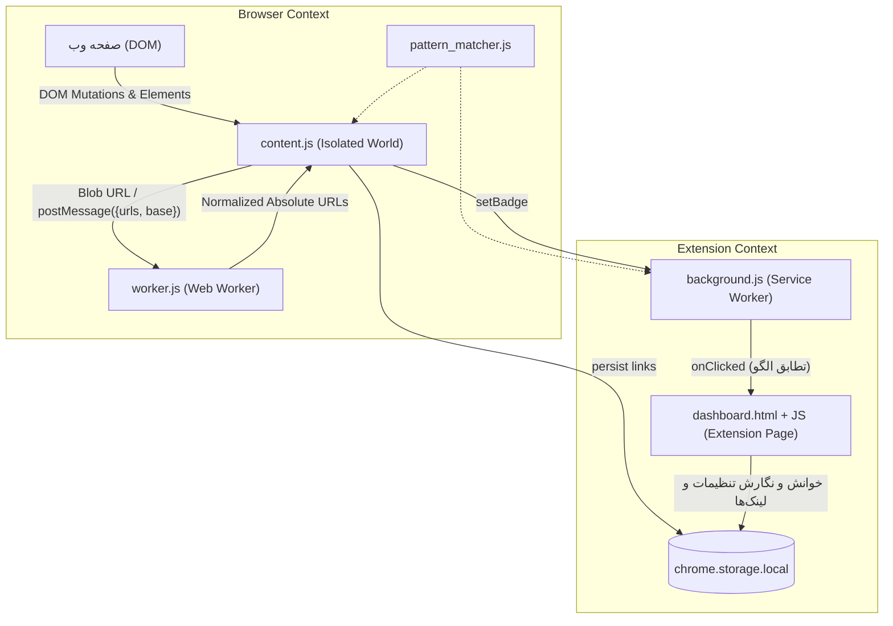
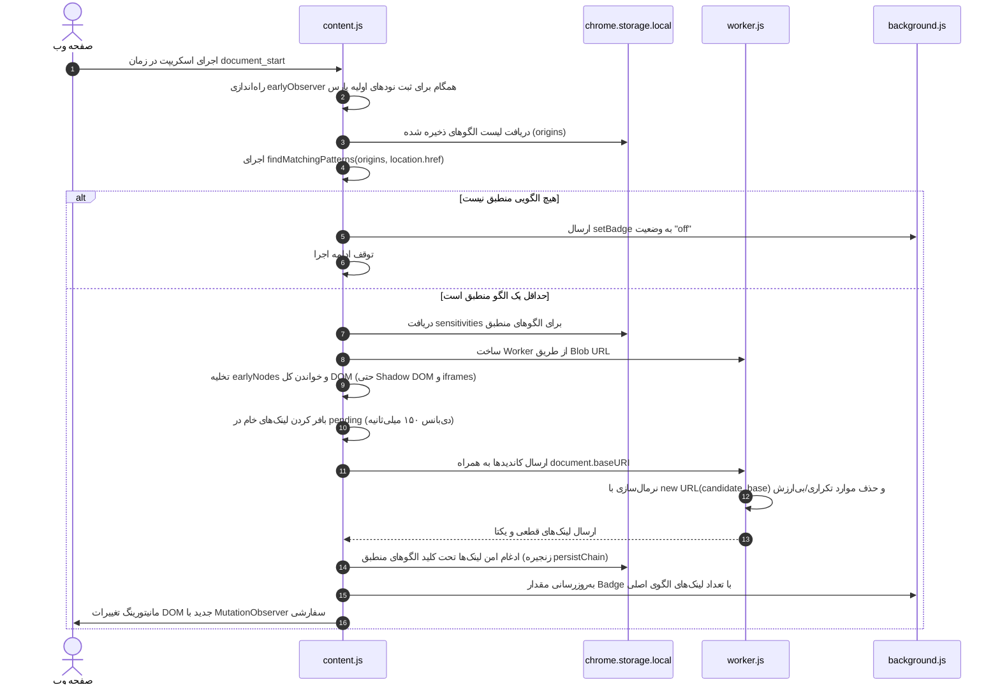

# مستندات جامع پروژه افزونه کروم — Automatic Link Extractor

> **هدف این مستند:** این فایل به عنوان مرجع اصلی و پایگاه دانش کامل پروژه تهیه شده است تا در هر زمان بتوان ساختار، معماری، منطق کد، قراردادها و باگ‌های شناخته‌شده را بررسی کرد. **این فایل طبق تعهد با هر تغییر جدید در پروژه به‌روزرسانی خواهد شد.**

---

## ۱. معرفی کلی و هدف پروژه

افزونه **Automatic Link Extractor** یک افزونه برای مرورگر گوگل کروم بر پایه **Manifest V3** است که به منظور کشف و استخراج خودکار و بلادرنگ پیوندها (Links / URLs) طراحی شده است. این افزونه دو وظیفه و پایپ‌لاین اصلی دارد:

1. **استخراج زنده پیوندها از ساختار DOM با پشتیبانی از Wildcard Patterns (Live DOM Link Extraction):**
   یک Content Script روی وب‌سایت‌هایی که کاربر فعال (Enable) کرده یا با الگوهای وایلدکارد منطبق است اجرا می‌شود و با استفاده از `MutationObserver` هرگونه تغییر در ساختار صفحه را زیر نظر گرفته و تمامی پیوندها را از ویژگی‌های مختلف HTML (مانند `href`, `src`, `action`, `data-*` و ...) استخراج می‌کند. پیوندها به تفکیک الگو/دامنه ذخیره شده و تعداد آن‌ها در نشانگر (Badge) آیکون افزونه نمایش داده می‌شود.

2. **خزنده و تحلیل‌گر فایل‌های جاوااسکریپت (JavaScript File Crawler):**
   از طریق داشبورد افزونه، کاربر می‌تواند تمام فایل‌های اسکریپت (`.js`) کشف‌شده از دامنه را انتخاب کرده و محتوای آن‌ها را خزش (Crawl) کند تا با استفاده از الگوهای Regex بهینه‌سازی‌شده، تمامی مسیرها، اندپوینت‌های API و پیوندهای مطلق و نسبی داخل فایل‌های جاوااسکریپت استخراج شوند.

> **ویژگی فنی مهم:** این پروژه کاملاً با **Vanilla JavaScript** (جاوااسکریپت خالص استاندارد مدرن مرورگر) پیاده‌سازی شده و هیچ‌گونه وابستگی، پکیج NPM، بیلد تول (Webpack/Vite/Rollup) یا فریمورک فرانت‌اند ندارد. به صورت مستقیم در حالت Developer Mode کروم بارگذاری (Load unpacked) می‌شود.

---

## ۲. سیستم الگوها و Wildcard Matching

افزونه به جای محدود بودن به تطابق دقیق یک Origin خاص، از انواع الگوهای پیشرفته وایلدکارد پشتیبانی می‌کند:

| نوع الگو | مثال ورودی | توضیحات و دامنه پوشش |
|---|---|---|
| **ساب‌دامنه‌ها + ریشه** | `https://*.google.com` | پوشش کامل دامنه اصلی (`google.com`) و تمام زیردامنه‌ها (`mail.google.com`, `a.b.google.com`) با هر مسیری |
| **مسیرهای پیشوندی** | `https://google.com/*` | پوشش تمامی صفحات و اندپوینت‌هایی که با `https://google.com/` شروع می‌شوند (`/search`, `/images`, ...) |
| **مسیرهای خاص** | `https://google.com/search/*` | پوشش صفحات خاص یک بخش، مثلاً مسیرهای تحت `/search` |
| **ترکیب ساب‌دامنه و مسیر** | `https://*.google.com/*` | پوشش تمام ساب‌دامنه‌ها و تمام مسیرها |
| **مبدأ سنتی دقیق** | `https://google.com` | رفتار سنتی؛ استخراج لینک از تمام صفحات این مبدأ |
| **پروتکل آزاد** | `*.google.com` یا `*://*.google.com/*` | پوشش هر دو پروتکل `http` و `https` |
| **پورت‌های لوکال** | `http://localhost:3000` یا `http://localhost:*` | تست و توسعه روی پورت‌های لوکال هاست |

منطق تبدیل الگو به رگکس و بررسی تطابق به شکل مجزا در ماژول [`assets/js/pattern_matcher.js`](file:///d:/tools/Automatic%20Link%20Extractor%20-%20Chrome%20extension/assets/js/pattern_matcher.js) پیاده‌سازی شده و در تمامی محیط‌ها (`content.js`, `background.js`, `dashboard.html`) به اشتراک گذاشته شده است.

---

## ۳. معماری فنی و فضاهای اجرا (Execution Contexts)



| محیط / کامپوننت | فایل مربوطه | دسترسی به DOM؟ | دسترسی به API کروم؟ | وظیفه اصلی |
|---|---|:---:|:---:|---|
| **Service Worker** | `background.js` | ❌ خیر | ✅ بله (`chrome.*`) | لود `pattern_matcher.js` با `importScripts`، مدیریت کلیک، تشخیص الگوی منطبق با تب فعال و باز کردن داشبورد. |
| **Content Script** | `assets/js/pattern_matcher.js` + `content.js` | ✅ بله (Isolated) | ✅ بله (محدود به `storage`, `runtime`) | بررسی تطابق URL جاری با الگوهای وایلدکارد، نظارت بر DOM، ارسال کاندیدها به ورکر، ذخیره لینک‌ها در کلید مربوط به الگو. |
| **Web Worker** | `worker.js` | ❌ خیر | ❌ خیر (سندباکس ایزوله) | پردازش پس‌زمینه و موازی URLها، فیلتر اسکیماهای نامعتبر و نرمال‌سازی لینک‌ها. |
| **Extension Page** | `dashboard.html` + `assets/js/*` | ✅ بله (DOM داشبورد) | ✅ بله (دسترسی کامل) | رابط کاربری مدیریت الگوها، تنظیم حساسیت، مشاهده لینک‌ها با صفحه‌بندی امن و مودال خزنده JS. |

---

## ۴. جریان داده و پایپ‌لاین‌های استخراج (Extraction Pipelines)

### ۴.۱. پایپ‌لاین اول: استخراج زنده از DOM (Pipeline A)

این فرآیند به شکل زنده در هر صفحه‌ای که آدرس آن با یکی از الگوهای ثبت شده منطبق باشد اجرا می‌شود:



#### ویژگی‌های تحت پایش (`LINK_ATTRIBUTES`):
`href`, `src`, `srcset`, `action`, `formaction`, `data-url`, `data-href`, `data-src`, `poster`, `cite`, `background`, `profile`, `manifest`, `longdesc`, `data`.

---

### ۴.۲. پایپ‌لاین دوم: خزنده فایل‌های جاوااسکریپت (Pipeline B)

این فرآیند درون صفحه داشبورد و با درخواست کاربر اجرا می‌شود:
1. کاربر روی **Extract links from JS files** کلیک می‌کند.
2. اسکریپت‌های استخراج‌شده برای آن الگو از استوریج واکشی می‌شوند.
3. کاربر فایل‌ها و گزینه‌ها (مانند Decode URLs یا عبارات فیلتر Include/Exclude) را مشخص و دکمه **Crawl** را می‌زند.
4. با ارسال درخواست‌های `fetch` به فایل‌های JS، محتوا با دو رگکس استخراج می‌شود:
   - **لینک‌های مطلق:** `/(?:(?:https?|ftps?|wss?):)?\/\/[^\s"'`<>\\^|{}\[\]]+/gi`
   - **لینک‌های نسبی:** `/["'`]((?:\.\.?\/|\/(?!\/))[^"'`\s\\]*)["'`]/g`
5. تمام لینک‌های نسبی به صورت خودکار بر اساس URL خود فایل اسکریپت (`response.url`) به لینک قطعی و مطلق تبدیل می‌شوند.
6. با کلیک روی **Add links**، لینک‌های جدید مستقیماً به بانک لینک‌های آن الگو اضافه می‌شوند.

---

## ۵. ساختار داده در `chrome.storage.local`

فضای ذخیره‌سازی محلی افزونه شامل چهار کلید اصلی است:

### ۵.۱. `origins` (`string[]`)
آرایه‌ای از الگوها و دامنه‌های ثبت‌شده، شامل دامنه‌های دقیق یا عبارات وایلدکارد:
```json
[
  "https://*.google.com",
  "https://example.com/*",
  "http://localhost:3000"
]
```

### ۵.۲. `sensitivities` (`{ [pattern: string]: Object }`)
تنظیمات پرچم‌های `MutationObserver` به ازای هر الگو (به صورت پیش‌فرض با `1` ایجاد می‌شوند):
```json
{
  "https://*.google.com": {
    "childList": 1,
    "subtree": 1,
    "attributes": 1,
    "attributeOldValue": 1,
    "characterData": 1,
    "characterDataOldValue": 1
  }
}
```

### ۵.۳. `regexes` (`{ [pattern: string]: { includes: string[], excludes: string[] } }`)
الگوهای فیلتر شمول یا عدم شمول خزشگر فایل‌های JS به تفکیک هر الگو:
```json
{
  "https://*.google.com": {
    "includes": ["api", "YOUR_REGEX"],
    "excludes": ["node_modules", "YOUR_REGEX"]
  }
}
```

### ۵.۴. `links` (`{ [pattern: string]: string[] }`)
مجموعه لینک‌های یکتای استخراج‌شده برای آن الگو (مثلاً برای `https://*.google.com` شامل لینک‌های جمع‌آوری‌شده از `google.com` و تمامی ساب‌دامنه‌ها):
```json
{
  "https://*.google.com": [
    "https://google.com/",
    "https://mail.google.com/mail/u/0/",
    "https://drive.google.com/drive/my-drive"
  ]
}
```

---

## ۶. بررسی تفکیکی فایل‌های پروژه

### `assets/js/pattern_matcher.js` *(جدید)*
- ماژول متمرکز و مستقل برای تطابق الگوها و وایلدکاردها.
- توابع کلیدی:
  - `escapeRegex(str)`: فرار کاراکترهای خاص به جز وایلدکارد.
  - `patternToRegex(pattern)`: تبدیل الگوهای وایلدکارد (`https://*.domain.com`, `https://domain.com/*`, ...) به یک شیء `RegExp` استاندارد و دقیق.
  - `matchPattern(pattern, url)`: تست انطباق یک آدرس با یک الگو.
  - `findMatchingPatterns(patterns, url)`: فیلتر کردن تمام الگوهای منطبق برای یک آدرس.

### `manifest.json`
- تعریف استاندارد **Manifest V3**.
- اضافه شدن `assets/js/pattern_matcher.js` به عنوان اسکریپت پیش‌نیاز در `content_scripts` قبل از `content.js`.
- دسترسی به میزبان: `<all_urls>`.

### `background.js` (Service Worker)
- بارگذاری `pattern_matcher.js` با استفاده از `importScripts`.
- در زمان کلیک کاربر روی آیکون، آدرس تب فعال (`tab.url`) را با الگوهای ثبت‌شده تطبیق داده و در صورت انطباق، مستقیماً داشبورد مربوط به همان الگو را باز یا فوکوس می‌کند.

### `content.js` (Content Script)
- اجرای زودهنگام در `document_start`.
- استفاده از `findMatchingPatterns(arr, location.href)` برای تشخیص فعال بودن پایش در صفحه جاری.
- ادغام لینک‌های جدید در بانک لینک‌های تمامی الگوهای منطبق در `persist(links)`.

### `assets/js/dash_checker.js`
- بازنویسی کامل با `URLSearchParams`؛ برطرف کردن روش شکننده قدیمی (`.split("origin=")[1]`) و پشتیبانی کامل و بدون خطا از کاراکترهای وایلدکارد و پارامترهای مختلف.

### `assets/js/addorigin.js`
- افزودن الگوها با انکود امن URL (`encodeURIComponent`).
- مقداردهی اولیه `sensitivities`، `regexes` و `links`.
- پاک‌سازی کامل تمام کلیدهای وابسته (`sensitivities`, `regexes`, `links`) در هنگام حذف یک الگو.

### `assets/js/dashboard.js`
- حل مشکل کرش صفحه در زمان خالی بودن لینک‌ها (گارد روی `page_count > 0`).
- رفع باگ دکمه ضربدر حذف تکی لینک با پیاده‌سازی تابع اختصاصی `remove_link_from_origin`.
- نمایش تعداد کل لینک‌های استخراج‌شده برای الگو در هدر داشبورد.

### `dashboard.html`
- به‌روزرسانی placeholder ورودی افزودن مبدأ/الگو (`Enter origin or pattern (e.g. https://*.google.com, https://google.com/*)...`).
- لود ماژول `pattern_matcher.js`.

---

## ۷. آخرین تغییرات اعمال شده در پروژه (Git History)

1. **پشتیبانی کامل از Wildcard Patterns (کامیت جاری):**
   - افزودن امکان ثبت الگوهایی مانند `https://*.google.com` (ساب‌دامنه‌ها و دامنه ریشه) و `https://google.com/*` (مسیرهای پیشوندی).
   - ایجاد ماژول مستقل `assets/js/pattern_matcher.js`.
   - همگام‌سازی `content.js` و `background.js` با موتور تشخیص الگو.
2. **رفع باگ‌ها و ارتقای پایداری داشبورد (کامیت جاری):**
   - برطرف کردن باگ دکمه حذف تکی لینک در `dashboard.js` با تابع `remove_link_from_origin`.
   - رفع خطای کرش صفحه‌بندی در زمان صفر بودن تعداد لینک‌ها در `dashboard.js`.
   - ارتقای `dash_checker.js` به استفاده از `URLSearchParams`.
   - پاک‌سازی کامل اطلاعات یتیم در استوریج زمان حذف یک مبدأ در `addorigin.js`.
3. **هدایت مستقیم به داشبورد پس از افزودن مبدأ (`4c681b0`):**
   - ریدایرکت خودکار به تب داشبورد مبدأ اضافه شده.
4. **قابلیت Decode کردن لینک‌های استخراج‌شده در مودال (`c59309d`):**
   - افزودن چک‌باکس `decode-urls`.
5. **ذخیره‌سازی پایدار Regexهای کاربر (`f3dd905`):**
   - متد `save_regex_to_storage` برای حفظ عبارات فیلتر Include/Exclude.
6. **تنظیم پیش‌فرض حساسیت‌ها به مقدار ۱ (`93f321e`):**
   - فعال بودن پیش‌فرض تمام فلگ‌های `MutationObserver`.

---

## ۸. باگ‌ها، رفتارهای غیرمنتظره و نکات فنی قابل بهبود (Known Issues)

1. ⚠️ **امکان بروز خطا با ورودی نامعتبر Regex در مودال:**
   کد `new RegExp(pattern, 'i')` مستقیماً روی متن‌های ویرایش‌شده کاربر در `contenteditable` اجرا می‌شود؛ ورودی‌های نامعتبر کاربر باید با `try / catch` محافظت شوند.
2. ⚠️ **امنیت تزریق DOM در لیست فایل‌های JS (`modal.js`):**
   در تابع `renderJsFileList` از اینترپولیشن مستقیم در `innerHTML` استفاده شده است (`href="${link}"` و `title="${link}"`). استفاده از متدهای امن مانند `setAttribute` ترجیح دارد.
3. ⚠️ **کد مرده (Dead Code) در پیام‌رسانی:**
   خط `window.postMessage({ action: "continue", ... })` در `content.js` پیامی ارسال می‌کند که در هیچ‌کجای پروژه هیچ لیسنری برای آن وجود ندارد.
4. ⚠️ **مجوز بلااستفاده `scripting` در مانیفست:**
   در `manifest.json` پرمیشن `scripting` درخواست شده اما در هیچ فایلی از API `chrome.scripting` استفاده نشده است.
5. ⚠️ **محدودیت احتمالی CSP برای Blob Worker در برخی سایت‌ها:**
   برخی از سایت‌ها با فعال‌سازی هدر سخت‌گیرانه `Content-Security-Policy` با مقدار `worker-src 'none'` ممکن است مانع ساخت Web Worker از طریق Blob URL در `content.js` شوند.
6. ⚠️ **گزینه `base-url-predict` در پنجره مودال:**
   در HTML و استایل‌ها وجود دارد و متغیر آن در `modal.js` خوانده می‌شود، اما منطق کاربردی آن هنوز به طور کامل درون فیلتر خزش اعمال نشده است.

---

## ۹. راهنمای بارگذاری، توسعه و تست

1. مرورگر گوگل کروم را باز کرده و به نشانی `chrome://extensions/` بروید.
2. گزینه **Developer mode** را در بالا سمت راست فعال کنید.
3. دکمه **Load unpacked** را زده و پوشه ریشه این پروژه را انتخاب نمایید.
4. پس از اعمال هرگونه تغییر در کدهای پروژه:
   - در صورت تغییر `background.js`، `manifest.json`، `pattern_matcher.js` یا `content.js`: دکمه **Reload (آیکون چرخش)** کارت افزونه را در صفحه Extensions کلیک کنید و تب تست را رفرش نمایید.
   - در صورت تغییر در فایل‌های داشبورد (`dashboard.html`, `assets/js/*`, `assets/styles/*`): کافیست تب داشبورد را در مرورگر Refresh نمایید.
5. برای تست سریع صحت نحوی کدها در محیط ترمینال می‌توانید دستور زیر را اجرا کنید:
   ```powershell
   node --check background.js content.js worker.js assets/js/pattern_matcher.js assets/js/addorigin.js assets/js/dashboard.js assets/js/dash_checker.js assets/js/helpers.js assets/js/modal.js assets/js/sensitivities.js
   ```

---

## ۱۰. تعهد به‌روزرسانی مستندات

> **قانون طلایی پروژه:** با درخواست هرگونه تغییر در عملکرد، فایل‌ها، منطق استخراج، رفع باگ‌ها یا افزودن فیچرهای جدید، **این فایل (`PROJECT_DOCUMENTATION.md`) باید همگام با تغییرات کد به‌روزرسانی شود** تا همواره آخرین وضعیت پروژه را به صورت مستند و قابل رجوع منعکس کند.
