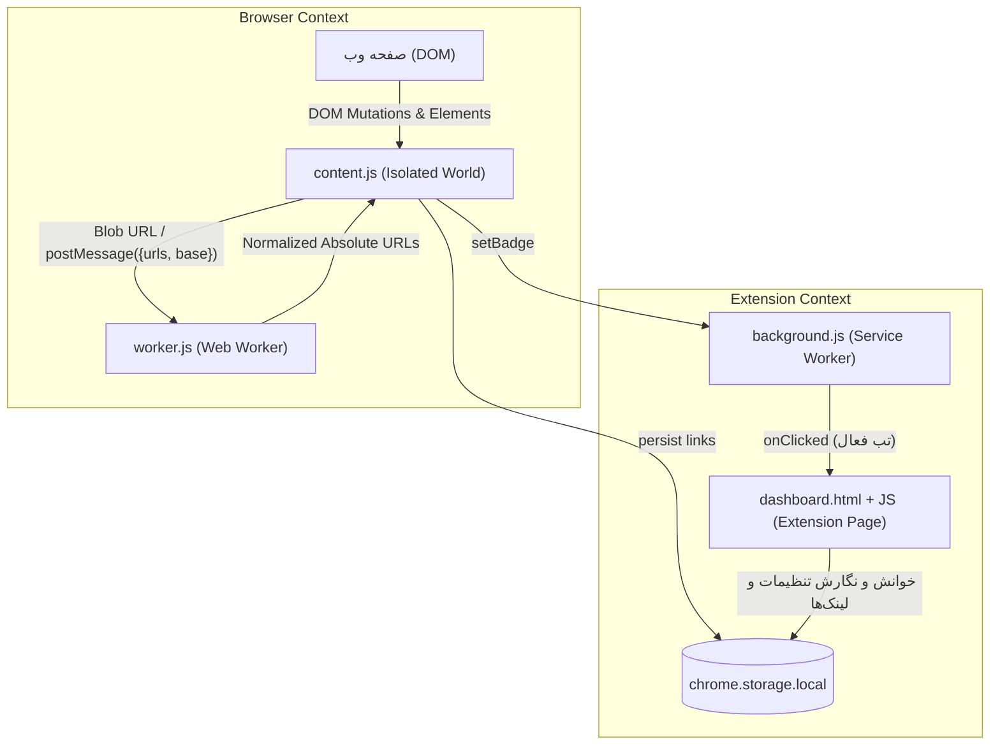
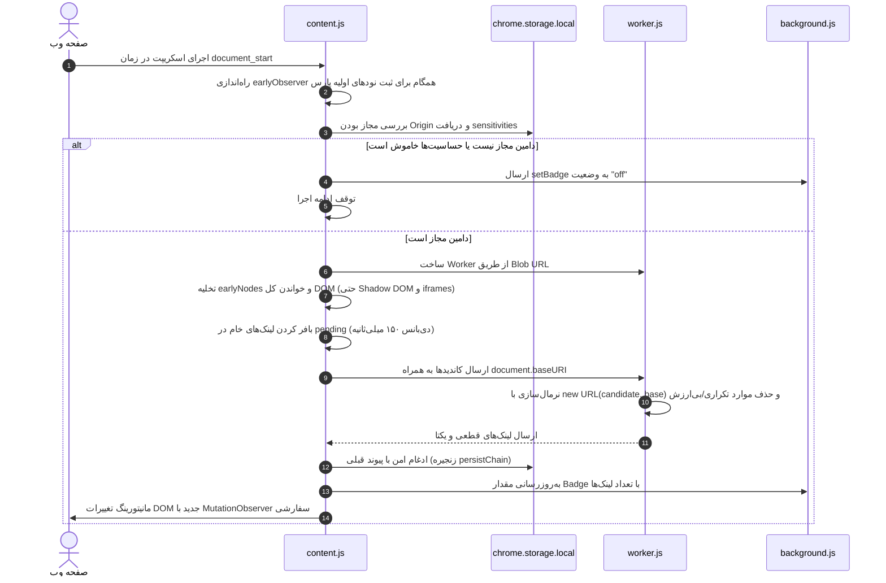
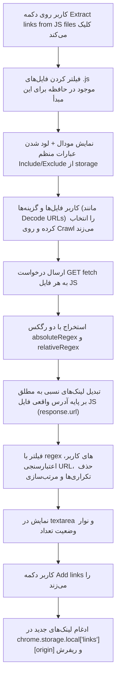

# مستندات جامع پروژه افزونه کروم — Automatic Link Extractor

> **هدف این مستند:** این فایل به عنوان مرجع اصلی و پایگاه دانش کامل پروژه تهیه شده است تا در هر زمان بتوان ساختار، معماری، منطق کد، قراردادها و باگ‌های شناخته‌شده را بررسی کرد. **این فایل طبق تعهد با هر تغییر جدید در پروژه به‌روزرسانی خواهد شد.**

---

## ۱. معرفی کلی و هدف پروژه

افزونه **Automatic Link Extractor** یک افزونه برای مرورگر گوگل کروم بر پایه **Manifest V3** است که به منظور کشف و استخراج خودکار و بلادرنگ پیوندها (Links / URLs) طراحی شده است. این افزونه دو وظیفه و پایپ‌لاین اصلی دارد:

1. **استخراج زنده پیوندها از ساختار DOM (Live DOM Link Extraction):**
   یک Content Script روی وب‌سایت‌هایی که کاربر فعال (Enable) کرده است اجرا می‌شود و با استفاده از `MutationObserver` هرگونه تغییر در ساختار صفحه را زیر نظر گرفته و تمامی پیوندها را از ویژگی‌های مختلف HTML (مانند `href`, `src`, `action`, `data-*` و ...) استخراج می‌کند. پیوندها به تفکیک دامنه (Origin) ذخیره شده و تعداد آن‌ها در نشانگر (Badge) آیکون افزونه نمایش داده می‌شود.

2. **خزنده و تحلیل‌گر فایل‌های جاوااسکریپت (JavaScript File Crawler):**
   از طریق داشبورد افزونه، کاربر می‌تواند تمام فایل‌های اسکریپت (`.js`) کشف‌شده از دامنه را انتخاب کرده و محتوای آن‌ها را خزش (Crawl) کند تا با استفاده از الگوهای Regex بهینه‌سازی‌شده، تمامی مسیرها، اندپوینت‌های API و پیوندهای مطلق و نسبی داخل فایل‌های جاوااسکریپت استخراج شوند.

> **ویژگی فنی مهم:** این پروژه کاملاً با **Vanilla JavaScript** (جاوااسکریپت خالص استاندارد مدرن مرورگر) پیاده‌سازی شده و هیچ‌گونه وابستگی، پکیج NPM، بیلد تول (Webpack/Vite/Rollup) یا فریمورک فرانت‌اند ندارد. به صورت مستقیم در حالت Developer Mode کروم بارگذاری (Load unpacked) می‌شود.

---

## ۲. معماری فنی و فضاهای اجرا (Execution Contexts)

یکی از مهم‌ترین نکات برای درک و ویرایش این افزونه، تفاوت **فضاهای اجرای مستقل (Contexts)** در اکوسیستم افزونه‌های کروم است:



| محیط / کامپوننت | فایل مربوطه | دسترسی به DOM؟ | دسترسی به API کروم؟ | وظیفه اصلی |
|---|---|:---:|:---:|---|
| **Service Worker** | `background.js` | ❌ خیر | ✅ بله (`chrome.*`) | مدیریت کلیک روی آیکون افزونه، مدیریت Badge تب‌ها و باز کردن داشبورد. |
| **Content Script** | `content.js` | ✅ بله (Isolated) | ✅ بله (محدود به `storage`, `runtime`) | نظارت بر DOM صفحه در زمان لود و تغییرات، ارسال کاندیدها به ورکر، ذخیره لینک‌ها. |
| **Web Worker** | `worker.js` | ❌ خیر | ❌ خیر (سندباکس ایزوله) | پردازش پس‌زمینه و موازی URLها، فیلتر اسکیماهای نامعتبر و نرمال‌سازی لینک‌ها. |
| **Extension Page** | `dashboard.html` + `assets/js/*` | ✅ بله (DOM داشبورد) | ✅ بله (دسترسی کامل) | رابط کاربری افزودن Originها، تنظیم حساسیت، مشاهده لینک‌ها و مودال خزنده JS. |

---

## ۳. جریان داده و پایپ‌لاین‌های استخراج (Extraction Pipelines)

### ۳.۱. پایپ‌لاین اول: استخراج زنده از DOM (Pipeline A)

این فرآیند به شکل زنده در هر صفحه‌ای که Origin آن در لیست افزونه ثبت شده باشد اجرا می‌شود:



#### ویژگی‌های تحت پایش (`LINK_ATTRIBUTES`):
`href`, `src`, `srcset`, `action`, `formaction`, `data-url`, `data-href`, `data-src`, `poster`, `cite`, `background`, `profile`, `manifest`, `longdesc`, `data`.
- ویژگی `srcset` به شکل خاص پارس می‌شود تا همه URLهای درون آن استخراج گردند.
- تمام ریشه‌های باز Shadow DOM (`element.shadowRoot`) به صورت بازگشتی پویش می‌شوند.
- آی‌فریم‌های هم‌مبدأ (`same-origin iframes`) نیز به صورت بازگشتی خوانده می‌شوند.

---

### ۳.۲. پایپ‌لاین دوم: خزنده فایل‌های جاوااسکریپت (Pipeline B)

این فرآیند درون صفحه داشبورد و با درخواست کاربر اجرا می‌شود:



#### رگکس‌های موتور خزش در `modal.js`:
- **لینک‌های مطلق:**
  ```javascript
  const absoluteRegex = /(?:(?:https?|ftps?|wss?):)?\/\/[^\s"'`<>\\^|{}\[\]]+/gi;
  ```
- **لینک‌های نسبی (فقط درون نقل‌قول‌های معتبر):**
  ```javascript
  const relativeRegex = /["'`]((?:\.\.?\/|\/(?!\/))[^"'`\s\\]*)["'`]/g;
  ```

---

## ۴. ساختار داده در `chrome.storage.local`

فضای ذخیره‌سازی محلی افزونه شامل چهار کلید اصلی است:

### ۴.۱. `origins` (`string[]`)
آرایه‌ای از دامنه‌ها/مبدأهای فعال شده، مانند:
```json
[
  "https://example.com",
  "https://dashboard.target.org"
]
```

### ۴.۲. `sensitivities` (`{ [origin: string]: Object }`)
تنظیمات پرچم‌های `MutationObserver` به ازای هر دامنه. از آخرین کامیت‌ها، به صورت پیش‌فرض مقادیر با `1` ایجاد می‌شوند:
```json
{
  "https://example.com": {
    "childList": 1,
    "subtree": 1,
    "attributes": 1,
    "attributeOldValue": 1,
    "characterData": 1,
    "characterDataOldValue": 1
  }
}
```

### ۴.۳. `regexes` (`{ [origin: string]: { includes: string[], excludes: string[] } }`)
عبارات باقاعده سفارشی کاربر برای فیلتر استخراج فایل‌های جاوااسکریپت که به صورت خودکار در حافظه ذخیره می‌شوند:
```json
{
  "https://example.com": {
    "includes": ["api", "v1", "YOUR_REGEX"],
    "excludes": ["node_modules", "vendor", "YOUR_REGEX"]
  }
}
```

### ۴.۴. `links` (`{ [origin: string]: string[] }`)
لیست نهایی لینک‌های استخراج‌شده برای هر دامنه (به صورت کاملاً Absolute و بدون موارد تکراری):
```json
{
  "https://example.com": [
    "https://example.com/",
    "https://example.com/assets/app.js",
    "https://example.com/api/v1/user/profile"
  ]
}
```

---

## ۵. بررسی تفکیکی فایل‌های پروژه

### `manifest.json`
- تعریف افزونه در استاندارد **Manifest V3**.
- مجوزها (`permissions`): `storage`, `scripting`, `tabs` (توضیح: `scripting` فعلاً استفاده نشده است).
- دسترسی به میزبان (`host_permissions`): `<all_urls>` برای نظارت در همه سایت‌های تعریف‌شده.
- تعیین `background.service_worker` به عنوان `background.js`.
- تزریق `content.js` در زمان `document_start`.
- تعریف `worker.js` در `web_accessible_resources` برای امکان ساخت Blob Worker.

### `background.js` (Service Worker)
- **شنونده پیام `setBadge`:** رنگ و متن نشانگر آیکون افزونه در تب فعال را تنظیم می‌کند (مثلاً تعداد لینک‌ها یا `"off"`).
- **شنونده کلیک روی آیکون (`chrome.action.onClicked`):**
  - استخراج مبدأ تب فعال با `new URL(tab.url).origin`.
  - در صورت وجود تب داشبورد باز، روی آن فوکوس می‌کند.
  - در غیر این صورت، اگر مبدأ در لیست ذخیره باشد صفحه را با `?origin=...` و در غیر این صورت با فرم افزودن `?origin_add=...` باز می‌کند.

### `content.js` (Content Script) — قلب تپنده استخراج DOM
- **شروع زودهنگام (`document_start`):** قبل از این که DOM به‌طور کامل ساخته شود و قبل از لود تنظیمات از استوریج، یک `earlyObserver` فعال می‌کند تا حتی اگر تگی موقتاً در حین لود ساخته و حذف شد لینک‌های آن از دست نرود.
- **توابع پیمایش عمیق:**
  - `readElementLinks`: خواندن اتریبیوت‌ها و تفکیک مقادیر `srcset`.
  - `readRootLinks` و `readNodeLinks`: پویش المان‌ها و ورود به `shadowRoot`ها.
  - `readFrameLinks`: ورود به iframeهای هم‌مبدأ.
- **ارتباط با Worker:** ورکر را از طریق ساخت Blob لود می‌کند. لینک‌های خام را هر ۱۵۰ میلی‌ثانیه بافر و ارسال می‌کند.
- **جلوگیری از Race Condition (`persistChain`):** تمامی عملیات خواندن/نوشتن در `chrome.storage.local` درون یک زنجیره پرومیس سریالی می‌شوند تا پاسخی از ورکر، دیتای پاسخ قبلی را بازنویسی (Clobber) نکند.

### `worker.js` (Web Worker)
- از اجرای عملیات سنگین نرمال‌سازی URLها روی نخ اصلی مرورگر (Main Thread) جلوگیری می‌کند.
- به آدرس صفحه دسترسی ندارد، به همین دلیل مبدأ را از `base` ارسالی از `content.js` می‌گیرد.
- اسکیماهای غیرواقعی (`data:`, `blob:`, `javascript:`, `about:`, `chrome:`, ...) را فیلتر می‌کند.
- تمام پیوندها را با `new URL(value, base).href` به آدرس مطلق تبدیل و dedupe می‌کند.

### `dashboard.html`
- قالب HTML یکپارچه برای دو نمای اصلی:
  1. نمای مدیریت مبدأها (`main_dashboard`)
  2. نمای داشبورد اختصاصی هر مبدأ (`origin_dashboard`) شامل سوئیچ‌های حساسیت، جدول لینک‌ها و پنجره مودال خزشگر اسکریپت‌ها.

### `assets/js/dash_checker.js`
- با بررسی پارامترهای آدرس مرورگر (`origin=` یا `origin_add=`) تصمیم می‌گیرد کدام نما (`main_dashboard` یا `origin_dashboard`) در صفحه باقی بماند و کدام حذف گردد.

### `assets/js/addorigin.js`
- افزودن دامنه جدید با دکمه Add یا کلید Enter.
- مقداردهی اولیه حساسیت‌ها (پیش‌فرض ۱ برای همه)، آرایه لینک‌ها و شیء Regex در استوریج.
- پس از افزودن دامنه، مستقیماً صفحه را به داشبورد همان مبدأ ریدایرکت می‌کند (`4c681b0`).
- امکان حذف مبدأ از لیست با دکمه x.

### `assets/js/dashboard.js`
- لود کردن وضعیت چک‌باکس‌های حساسیت بر اساس داده ذخیره‌شده.
- رندر کردن لینک‌های کشف‌شده برای دامین جاری با **صفحه‌بندی (Pagination - ۵ آیتم در هر صفحه)**.
- دکمه انتخاب همگانی (Select ALL) برای حساسیت‌ها.

### `assets/js/sensitivities.js`
- ثبت تغییرات چک‌باکس‌های ۶‌گانه `MutationObserver` و ذخیره آن‌ها در `chrome.storage.local` به عنوان `0` یا `1`.
- هماهنگ‌سازی اتوماتیک وضعیت دکمه Select ALL در صورت تغییر تک‌تک آیتم‌ها.

### `assets/js/modal.js` (موتور خزنده جاوااسکریپت)
- استخراج لیست فایل‌های اسکریپت از آرایه لینک‌ها (`.includes(".js") && .startsWith("http")`).
- نمایش چک‌باکس برای هر اسکریپت به همراه لینک باز کردن در تب جدید.
- مدیریت گزینه‌های فیلتر عبارات منظم (Include / Exclude) و ذخیره بلادرنگ آنها در Storage (`f3dd905`).
- نوار پیشرفت خزش، ارسال درخواست‌های موازی `fetch`، استخراج لینک‌ها، نرمال‌سازی بر اساس URL نهایی فایل JS (`resolveAgainst`).
- پشتیبانی از دیکود خودکار URLها (`decode-urls`) در صورت فعال بودن چک‌باکس (`c59309d`).
- افزودن لینک‌های تازه کشف‌شده به دیتابیس لینک‌های مبدأ با کلیک روی Add links.

### `assets/js/helpers.js`
- توابع کمکی مشترک مانند `getQueryParam` و `copyToClipboard`.
- رویداد پاک‌سازی تمام پیوندهای یک دامنه (`removeAllBtn`) به همراه دیالوگ تاییدیه (`confirm`).
- رویداد کپی کردن همه لینک‌ها در حافظه موقت (`copy_all`).

### `assets/styles/style.css` و `assets/styles/modal.css`
- استایل‌های ظاهری بخش داشبورد، سوئیچ‌ها، کارت‌های لینک، صفحه‌بندی، نوار پیشرفت و پنجره مودال.

---

## ۶. آخرین تغییرات اعمال شده در پروژه (Git History)

بر اساس بررسی آخرین کامیت‌ها، تغییرات کلیدی اخیر عبارتند از:

1. **هدایت مستقیم به داشبورد پس از افزودن مبدأ (`4c681b0`):**
   با اضافه کردن مبدأ جدید در `addorigin.js`، کاربر بلافاصله به آدرس `?origin=...` هدایت می‌شود.
2. **قابلیت Decode کردن لینک‌های استخراج‌شده در مودال (`c59309d`):**
   اضافه شدن چک‌باکس `decode-urls` در پنجره مودال؛ در صورت فعال بودن، توابع `decodeURIComponent` روی تمام لینک‌های خروجی اعمال می‌شود.
3. **ذخیره‌سازی پایدار Regexهای کاربر (`f3dd905`):**
   افزوده شدن متد `save_regex_to_storage` که با تایپ در باکس‌های رگکس، مقادیر فیلتر مستقیماً در استوریج افزونه ذخیره می‌شوند تا در دفعات بعدی باقی بمانند.
4. **تنظیم پیش‌فرض حساسیت‌ها به مقدار ۱ (`93f321e`):**
   تمام مقادیر `childList`, `subtree`, `attributes`, `attributeOldValue`, `characterData`, `characterDataOldValue` در زمان ساخت مبدأ جدید به صورت پیش‌فرض فعال (`1`) ذخیره می‌شوند.

---

## ۷. باگ‌ها، رفتارهای غیرمنتظره و نکات فنی قابل بهبود (Known Issues)

در هنگام توسعه و تغییر این پروژه، حتماً موارد زیر را مد نظر داشته باشید:

1. ⚠️ **خراب بودن دکمه حذف تکی لینک در `dashboard.js`:**
   در خط ۶۱ فایل `dashboard.js`، برای دکمه ضربدر حذف لینک، متد `remove_origin_from_list(value)` فراخوانی شده است؛ در حالی که متغیر `value` اصلاً در آن اسکوپ تعریف نشده و تابع فراخوانی‌شده هم برای حذف دامنه است نه لینک! در حال حاضر قابلیتی برای حذف تک‌لینک وجود ندارد.
2. ⚠️ **خطای احتمالی در لود اولیه دامنه‌های بدون لینک در `dashboard.js`:**
   در تابع `loadOriginData`، اگر طول آرایه لینک‌ها صفر باشد، حلقه صفحه‌بندی اجرا نشده و متغیر `page_range` مقدار `undefined` می‌گیرد؛ در نتیجه `page_range.forEach` خطا ایجاد می‌کند.
3. ⚠️ **پارس شکننده پارامترهای آدرس در `dash_checker.js`:**
   به جای استفاده از `URLSearchParams` استاندارد، از متد رشته‌ای `.split("origin=")[1]` استفاده شده است که در صورت وجود پارامترهای دیگر در URL ممکن است دچار باگ شود.
4. ⚠️ **امکان بروز خطا با ورودی نامعتبر Regex در مودال:**
   کد `new RegExp(pattern, 'i')` مستقیماً روی متن‌های ویرایش‌شده کاربر در `contenteditable` اجرا می‌شود؛ اگر کاربر یک کاراکتر نامعتبر (مانند پرانتز باز بدون بستن) وارد کند، فرآیند فیلتر کردن خطا داده و خزش متوقف می‌شود (نیاز به `try / catch`).
5. ⚠️ **امنیت تزریق DOM در لیست فایل‌های JS (`modal.js`):**
   در تابع `renderJsFileList` از اینترپولیشن مستقیم در `innerHTML` استفاده شده است (`href="${link}"` و `title="${link}"`). استفاده از متدهای امن مانند `setAttribute` یا ساخت المان ترجیح دارد.
6. ⚠️ **کد مرده (Dead Code) در پیام‌رسانی:**
   خط `window.postMessage({ action: "continue", ... })` در `content.js` پیامی ارسال می‌کند که در هیچ‌کجای پروژه هیچ لیسنری برای آن وجود ندارد.
7. ⚠️ **مجوز بلااستفاده `scripting` در مانیفست:**
   در `manifest.json` پرمیشن `scripting` درخواست شده اما در هیچ فایلی از API `chrome.scripting` استفاده نشده است.
8. ⚠️ **محدودیت احتمالی CSP برای Blob Worker در برخی سایت‌ها:**
   برخی از سایت‌ها با فعال‌سازی هدر سخت‌گیرانه `Content-Security-Policy` با مقدار `worker-src 'none'` ممکن است مانع ساخت Web Worker از طریق Blob URL در `content.js` شوند.
9. ⚠️ **گزینه `base-url-predict` در پنجره مودال:**
   در HTML و استایل‌ها وجود دارد و متغیر آن در `modal.js` خوانده می‌شود، اما منطق کاربردی آن هنوز به طور کامل درون فیلتر خزش اعمال نشده است.

---

## ۸. راهنمای بارگذاری، توسعه و تست

1. مرورگر گوگل کروم را باز کرده و به نشانی `chrome://extensions/` بروید.
2. گزینه **Developer mode** را در بالا سمت راست فعال کنید.
3. دکمه **Load unpacked** را زده و پوشه ریشه این پروژه را انتخاب نمایید.
4. پس از اعمال هرگونه تغییر در کدهای پروژه:
   - در صورت تغییر `background.js`، `manifest.json` یا `content.js`: دکمه **Reload (آیکون چرخش)** کارت افزونه را در صفحه Extensions کلیک کنید و تب تست را رفرش نمایید.
   - در صورت تغییر در فایل‌های داشبورد (`dashboard.html`, `assets/js/*`, `assets/styles/*`): کافیست تب داشبورد را در مرورگر Refresh نمایید.
5. برای تست سریع صحت نحوی کدها در محیط ترمینال می‌توانید دستور زیر را اجرا کنید:
   ```powershell
   node --check content.js worker.js background.js assets/js/modal.js assets/js/dashboard.js
   ```

---

## ۹. تعهد به‌روزرسانی مستندات

> **قانون طلایی پروژه:** با درخواست هرگونه تغییر در عملکرد، فایل‌ها، منطق استخراج، رفع باگ‌ها یا افزودن فیچرهای جدید، **این فایل (`PROJECT_DOCUMENTATION.md`) باید همگام با تغییرات کد به‌روزرسانی شود** تا همواره آخرین وضعیت پروژه را به صورت مستند و قابل رجوع منعکس کند.

