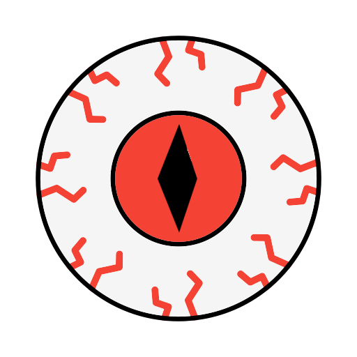
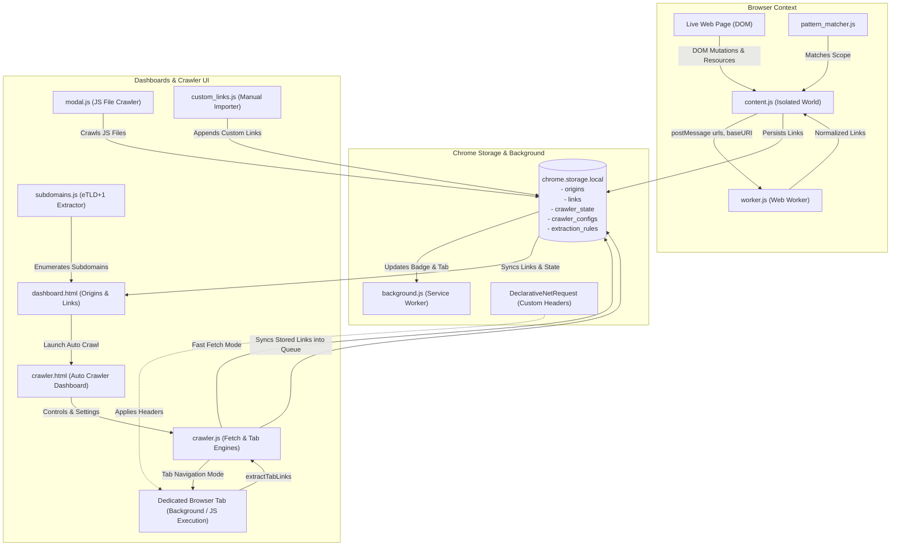
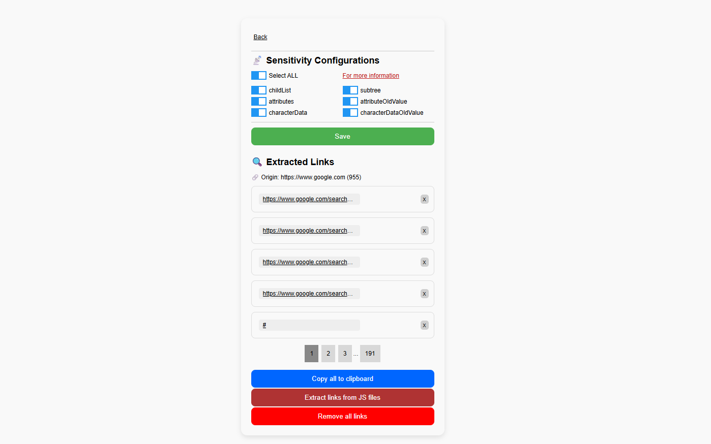

<p align="center">
  
</p>

<h1 align="center">Automatic Link Extractor</h1>

<p align="center">
  <strong>High-performance Chrome Extension (Manifest V3) for automated real-time DOM link extraction, dual-engine Auto Crawling, deep JavaScript endpoint extraction, wildcard scope matching, and domain intelligence.</strong>
</p>

<p align="center">
  
  
  
  
</p>

---

## 📖 Overview

**Automatic Link Extractor** is an advanced browser extension built for security researchers, penetration testers, bug bounty hunters, and web developers. 

It continuously monitors pages for DOM modifications, extracts hyperlinks, static assets, and API routes on the fly, offloads heavy URL processing to a background Web Worker, and offers an integrated dashboard for deep JavaScript crawling, subdomain enumeration, live link searching, manual endpoint management, and a dedicated **full-spectrum Auto Crawler engine**.

> [!NOTE]
> Designed with **zero build tools** and **zero third-party dependencies**—runs entirely on modern standard browser APIs.

---

## ✨ Key Features

### ⚡ 1. Real-Time DOM Link Extraction (Pipeline A)
- **Early Capture:** Executes at `document_start` with an early MutationObserver to capture dynamically injected elements, `<head>` resources, same-origin iframes, and Shadow DOM nodes.
- **Comprehensive Attribute Coverage:** Scans `href`, `src`, `srcset`, `action`, `formaction`, `data-url`, `data-href`, `data-src`, and more.
- **Offscreen Processing:** Batches raw attribute values and passes them to a background **Web Worker** (`worker.js`) for URL normalization, deduplication, and resolution against `document.baseURI` without blocking the main rendering thread.
- **Network Resource Timing Interception:** Passively observes background AJAX/fetch requests, beacons, and dynamically loaded network assets via `PerformanceObserver`.

### 🎯 2. Wildcard & Scope Pattern Matching
- Define flexible targets instead of static origins:
  - `https://*.example.com` — covers the root domain and all nested subdomains.
  - `https://example.com/*` — covers all endpoints and paths under `example.com`.
  - `https://*.example.com/*` — full wildcard scope across all subdomains and paths.
  - `*.example.com` or `*://*.example.com/*` — protocol-independent matching (`http` and `https`).
  - `http://localhost:*` — multi-port local development testing.

### 🕷️ 3. Dedicated Auto Crawler Engine (Dual-Engine Spider)
- **Dual-Engine Architecture:**
  - **Fast Fetch API Mode (Headless):** 100% silent background crawling with zero browser tabs opened, optimized for extreme speed, high throughput, and minimal resource usage.
  - **Tab-Driven Navigation Mode:** Spawns a dedicated browser tab to fully render client-side JavaScript, capture dynamic SPAs (React, Vue, Angular), session cookies, and background network calls.
- **Background Execution with Focus Lock (`tabBackground`):** Runs the crawler tab strictly in the background without stealing focus from your active tasks, backed by atomic tab creation and active-tab restoration.
- **Unlimited Crawling Capacity (`maxPages: 0`):** Set Max Total Pages to `0` for unbounded crawling until all queued URLs across the target domain are exhausted.
- **Continuous Live Queue Synchronization:** Continuously pulls newly discovered in-scope links from storage into the active queue during crawling, preventing premature crawl completion.
- **Strict Scope Containment:** Enforces strict domain and wildcard pattern boundaries automatically across initial seeding, mid-crawl synchronization, and link discovery.
- **Custom HTTP Request Headers:** Attach custom headers (e.g. `Authorization: Bearer <token>`, `Cookie`, `X-Custom-Header: value`) to requests in both Fetch and Tab modes via `declarativeNetRequest`.
- **URL Blacklist & Excluded Patterns:** Filter out sensitive or destructive URLs (`/admin/*`, `/logout`, `/private/*`) using flexible wildcard patterns or absolute URLs.
- **Configurable Request & Page Timeout:** Set maximum wait thresholds (in seconds) to skip unresponsive or hanging endpoints.
- **Dynamic Non-HTML Media & Asset Filter:** Custom comma-separated extension filter (`png, jpg, pdf, zip, ...`) with real-time badge counters and instant queue pruning.
- **Collapsible Settings Card:** Minimize/Maximize settings card with smooth CSS transitions to maximize viewport space for live logs.
- **Interactive Controls:** Real-time percentage progress bar, live queue counters, current crawling URL banner, and Start, Pause, Resume, Stop, and Reset controls.

### 🔬 4. Deep JavaScript File Crawler (Pipeline B)
- Directly extracts and inventories all collected `.js` script URLs.
- Fetches JavaScript sources asynchronously via `fetch` and analyzes script bodies using tuned regular expressions.
- Extracts hidden absolute URLs, relative API endpoints (`/api/v1/...`, `./endpoints`), and route definitions.
- Automatically resolves relative paths against the exact script URL (`resolveAgainst`).
- **Include / Exclude Regex Filters:** Interactive pills with instant preview.
- **URL Decoding:** Optional on-the-fly `decodeURIComponent` for encoded query strings.

### 🌐 5. Origins & Subdomains Extractor
- Discovers all unique origins and hostnames across all recorded links.
- **eTLD+1 Root Domain Filtering:** Built-in multi-part TLD support (`.co.uk`, `.ac.ir`, `.com.tr`, `.edu.au`, etc.) to isolate strictly target subdomains.
- **In-Memory Include/Exclude Filters:** Filter output live using regex without altering storage.
- **Protocol Toggle:** Switch between clean hostnames (`sub.domain.com`) and full origins (`https://sub.domain.com`).
- One-click copy to clipboard.

### 🔍 6. Live Search & Dynamic In-Place Pagination
- Search across thousands of extracted links in real-time as you type.
- **In-Place Pagination:** Smooth, blink-free page switching without full dashboard reloads.
- **State Preservation:** Keeps query parameters (`page` and `q`) synchronized in the URL via `history.replaceState`.
- **Filtered Copy:** Clicking `Copy all to clipboard` copies only the search-matched results when a search filter is active.

### ➕ 7. Manual Custom Links Importer
- Easily append custom endpoints, hidden paths, or recon lists directly to the target origin.
- Automatic whitespace trimming, blank line elimination, and `Set`-based deduplication.
- Live item counter and instantaneous dashboard update.

### ⚙️ 8. Granular MutationObserver Sensitivities & Extraction Rules
- Customize MutationObserver behavior per target (`childList`, `subtree`, `attributes`, `characterData`, etc.).
- Target-specific live regex Include/Exclude rules enforced dynamically in `content.js`.

---

## 🏗️ Architecture



---

## 🚀 Installation

1. **Clone or Download** this repository:
   ```bash
   git clone https://github.com/your-username/automatic-link-extractor.git
   ```
2. Open **Google Chrome** (or any Chromium-based browser such as Brave, Edge, or Arc).
3. Navigate to:
   ```text
   chrome://extensions/
   ```
4. Enable **Developer mode** using the toggle switch in the top-right corner.
5. Click the **Load unpacked** button in the top-left corner.
6. Select the project directory (`Automatic Link Extractor - Chrome extension`).

---

## 💡 How to Use

### 1. Adding a Target Scope
- Open the extension dashboard by clicking the extension icon or opening `chrome-extension://<id>/dashboard.html`.
- In the **Main Dashboard**, type your target URL or wildcard pattern:
  - Example: `https://*.target.com` or `https://target.com/*`
- Click **Add URL**. The extension will register the pattern, initialize default sensitivities, and redirect to the target's dedicated dashboard.

### 2. Live Link Collection
- Browse the target website normally in Chrome.
- The extension icon badge will reflect the number of unique links captured for that origin in real time.
- Clicking the extension icon while on an active target tab instantly focuses or opens that target's dashboard.

### 3. Using the Dedicated Auto Crawler
- In the target dashboard, click the orange **Auto Crawl** button (spider icon) below the Sensitivity Configurations.
- In the Auto Crawler panel (`crawler.html`):
  - **Set Crawling Limits:** Configure Crawl Delay, Max Depth, and Max Total Pages (`0` for Unlimited).
  - **Set Timeouts & Filters:** Specify Request Timeout, Blacklist URL patterns (`/admin/*`, `/logout`), and Excluded File Extensions (`png, jpg, css, js, ...`).
  - **Add Custom HTTP Headers:** Add authentication tokens or custom headers (`Authorization: Bearer ...`).
  - **Select Engine:** Keep unchecked for **Fast Fetch API** (silent, no tabs) or enable **Tab-driven Navigation** for full JS/SPA execution.
  - Click **Start** to initiate the crawl. Watch real-time progress, live queue counts, and activity logs.

### 4. Searching & Copying Links
- In the target dashboard, use the **🔍 Search extracted links...** input to filter results live.
- Click **Copy all to clipboard** to copy all links—or only the search-filtered results if a search is active.

### 5. Crawling JavaScript Files
- Click **Extract links from JS files**.
- Select the scripts you want to inspect.
- Configure Include/Exclude regex patterns or enable URL decoding if needed.
- Click **Crawl links**. Discovered routes will appear in the output window with status codes and can be added directly to your target links database.

### 6. Extracting Subdomains & Origins
- Click **Extract subdomains**.
- View all unique domains discovered across all links.
- Check **Only show TLD+1 subdomains** to focus exclusively on subdomains belonging to the target's root domain.
- Use Include/Exclude regex filters for fine-tuned recon analysis.

### 7. Adding Links Manually
- Click the green **`+`** button next to **🔍 Extracted Links**.
- Paste your custom list of URLs (one per line).
- Click **Add to links** to append them cleanly with automatic deduplication.

---

## 📂 Project Structure

```text
Automatic Link Extractor - Chrome extension/
├── manifest.json              # Chrome Extension Manifest (V3)
├── background.js              # Service Worker: badge & tab navigation
├── content.js                 # Content script: early DOM observer & worker bridge
├── worker.js                  # Web Worker: URL normalization & deduplication
├── dashboard.html             # Target & origins dashboard UI
├── crawler.html               # Dedicated Auto Crawler dashboard UI
├── README.md                  # Project documentation (this file)
├── PROJECT.md                 # Technical guide & contributor specification
├── PROJECT_DOCUMENTATION.md   # Comprehensive Persian reference & architectural manual
└── assets/
    ├── images/                # Extension icons, screenshots & vector SVGs
    │   ├── crawler.svg        # Spider/crawler action button icon
    │   ├── icon-512.png       # Primary extension branding logo
    │   ├── radar.png
    │   ├── screenshot1.png
    │   ├── screenshot2.png
    │   └── screenshot3.png
    ├── styles/
    │   ├── style.css          # Main dashboard stylesheet
    │   ├── crawler.css        # Auto Crawler dashboard stylesheet
    │   └── modal.css          # Crawler and subdomains modal stylesheets
    └── js/
        ├── pattern_matcher.js # Wildcard pattern parser and URL scope matcher
        ├── addorigin.js       # Target creation, search and paginated list logic
        ├── dash_checker.js    # View router (Main vs Target Dashboard)
        ├── dashboard.js       # Links renderer, live search & dynamic pagination
        ├── crawler.js         # Auto Crawler engine, tab navigation & queue manager
        ├── custom_links.js    # Manual link importer modal controller
        ├── subdomains.js      # eTLD+1 root domain & subdomain extractor modal
        ├── modal.js           # JavaScript file crawler modal
        ├── sensitivities.js   # MutationObserver sensitivity manager
        ├── settings.js        # Target extraction rules modal controller
        └── helpers.js         # Clipboard and storage utility helpers
```

---

## 🖼️ Screenshots

<p align="center">
  
  
</p>
<p align="center">
  
</p>

---

## 🛡️ Storage Schema

All data is stored locally in `chrome.storage.local`:

| Key | Type | Description |
|---|---|---|
| `origins` | `string[]` | List of enabled target origins and wildcard patterns. |
| `links` | `Record<string, string[]>` | Map of target pattern → deduplicated array of absolute URLs. |
| `sensitivities` | `Record<string, Record<string, number>>` | MutationObserver configuration flags (`childList`, `subtree`, etc.) per pattern. |
| `regexes` | `Record<string, { includes: string[], excludes: string[] }>` | Saved JS crawler regex filters per pattern. |
| `extraction_rules` | `Record<string, { includes: string[], excludes: string[] }>` | Per-target live regex inclusion/exclusion rules enforced by `content.js`. |
| `crawler_state` | `CrawlerState` | Active crawler execution state (status, queue, visited, progress, current target, logs). |
| `crawler_configs` | `Record<string, CrawlerSettings>` | Saved crawling configurations (delay, depth, max pages, headers, timeouts, blacklist) per target. |

---

## 🤝 Contributing

Contributions, feature requests, and bug reports are welcome!
Feel free to open an issue or submit a Pull Request.

1. Fork the Project.
2. Create your Feature Branch (`git checkout -b feature/AmazingFeature`).
3. Commit your Changes (`git commit -m "feat: add AmazingFeature"`).
4. Push to the Branch (`git push origin feature/AmazingFeature`).
5. Open a Pull Request.

---

## 📄 License

Distributed under the **MIT License**. See `LICENSE` for more information.  
All rights reserved © 2026.
