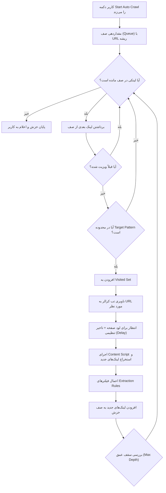

بله، این کار **کاملاً شدنی است** و در واقع تبدیل کردن این افزونه به یک **خزشگر بازگشتی خودکار (Recursive Web Crawler / Spider)**، آن را از یک ابزار passive به یک ابزار کشف و اسکن فوق‌العاده قدرتمند تبدیل می‌کند.

از آنجا که این خزشگر در محیط یک مرورگر واقعی (کروم) اجرا می‌شود، نسبت به اسکریپت‌های پایتونی یا ابزارهای سنتی برتری‌های چشمگیری دارد:
- اجرای کامل جاوااسکریپت، فریم‌ورک‌های SPA (مانند React و Vue) و رویدادهای داینامیک
- استفاده از همان کوکی‌ها و سشن لاگین کاربر (بدون نیاز به تنظیم مجدد احراز هویت)
- پشتیبانی همزمان از شکار درخواست‌های شبکه (`Resource Timing`) و تغییرات DOM

---

### ۱. دو روش اصلی برای پیاده‌سازی (Architecture Approaches)

برای پیاده‌سازی این قابلیت دو رویکرد فنی وجود دارد:

#### روش اول: ناوبری از طریق تب مرورگر (Tab-driven Navigation) — *پیشنهاد اصلی و ایده‌آل*
در این روش، افزونه یک تب اختصاصی (در پس‌زمینه یا به صورت Pinned) باز کرده و آدرس‌ها را یکی‌یکی در آن باز می‌کند:
1. سرویس‌ورکر (`background.js`) آدرس جدید را با `chrome.tabs.update` در تب بارگذاری می‌کند.
2. اسکریپت `content.js` صفحه را باز کرده، لینک‌های جدید را با DOM و Resource Timing استخراج می‌کند و به دیتابیس تحویل می‌دهد.
3. پس از لود کامل صفحه (و چند ثانیه مکث برای رندر شدن جاوااسکریپت)، تب به آدرس بعدی هدایت می‌شود.
- **مزایا:** پشتیبانی ۱۰۰٪ از جاوااسکریپت، فچ‌های پس‌زمینه، کوکی‌ها و سشن‌های لاگین.
- **معایب:** مصرف رم بیشتر و سرعت کمتر نسبت به ارسال صرف درخواست خام.

#### روش دوم: خزش با `fetch()` در پس‌زمینه (Background Headless Fetch)
مشابه الگوریتمی که در `modal.js` برای فایل‌های JS داریم، صفحات HTML به صورت متنی دانلود شده و با `DOMParser` لینک‌های آن استخراج می‌شوند.
- **مزایا:** سرعت بسیار بالا، مصرف منابع کم، بدون باز کردن تب.
- **معایب:** اسکریپت‌های کلاینت‌ساید (JS/React) اجرا نمی‌شوند و در سایت‌های SPA لینک‌های داینامیک شناسایی نخواهند شد.

> 💡 **پیشنهاد معماری:** روش اول (Tab-driven) به عنوان موتور اصلی انتخاب شود و در صورت تمایل می‌توان یک حالت **Fast Mode (Fetch)** هم در تنظیمات قرار داد.

---

### ۲. دیاگرام جریان کار (Workflow Diagram)



---

### ۳. ساختار داده و نیازمندی‌های کلیدی

برای پیاده‌سازی این سیستم، بخش‌های زیر باید تعریف شوند:

1. **مدیریت وضعیت خزش در `chrome.storage.local`:**
   ```javascript
   crawler_state: {
     target: "https://example.com",
     status: "idle" | "running" | "paused",
     tabId: 12345,
     queue: ["https://example.com/page1", "https://example.com/page2"],
     visited: ["https://example.com"],
     depthMap: { "https://example.com/page1": 1 },
     maxDepth: 3,
     delaySeconds: 2,
     maxPages: 500
   }
   ```

2. **کنترل محدوده (Scope & Boundary Enforcement):**
   - خزشگر نباید وارد لینک‌های خارجی (مثلاً `twitter.com`, `google.com`) شود. باید دقیقاً طبق تابع `findMatchingPatterns` با دامنه تارگت مطابقت داده شود.
   - فیلتر کردن پسوندهای غیروب: رد کردن خودکار فایل‌های سنگین مانند `.pdf`، `.zip`، `.png`، `.mp4`، `.exe`.

3. **یکسان‌سازی لینک‌ها (URL Canonicalization):**
   - حذف بخش Hash یا فرگمنت (`#section`) تا صفحات تکراری دو بار خزش نشوند.
   - مرتب‌سازی کوئری‌پارامترها و استانداردسازی اسلش انتهایی.

4. **جلوگیری از لوپ بی‌نهایت و تل‌های شنی (Crawler Traps):**
   - تعیین **سقف عمق (Max Depth)** (مثلاً ۳ یا ۵ لایه پیوند).
   - تعیین **سقف تعداد صفحات (Max Pages)** (مثلاً حداکثر ۲۰۰ یا ۵۰۰ صفحه).
   - نرخ ارسال درخواست (Rate Limiting) با تنظیم تاخیر ۱ تا ۳ ثانیه‌ای بین هر صفحه.

---

### ۴. طرح رابط کاربری در داشبورد (UI)

در تب هر تارگت در `dashboard.html` یک پنل کنترل کوچک اضافه می‌شود:
- **دکمه‌های کنترلی:** `▶ Start Auto Crawl`، `⏸ Pause`، `⏹ Stop`
- **تنظیمات خزشگر:**
  - فیلد *Delay (ثانیه)*: مثلاً `1.5` ثانیه
  - فیلد *Max Depth (عمق)*: مثلاً `3`
  - فیلد *Max Pages (سقف صفحه)*: مثلاً `300`
- **نشانگر وضعیت زنده:**
  - `In Queue: 45` | `Visited: 82` | `Current: https://example.com/blog/page/2`

---

اگر موافق باشید، می‌توانیم این قابلیت را مرحله‌به‌مرحله به صورت ماژولار پیاده‌سازی کنیم (ابتدا ساختار کنترلر و صف در `background.js`، سپس اتصال به تب خزشگر و در نهایت پنل UI در داشبورد). نظرتان چیست؟